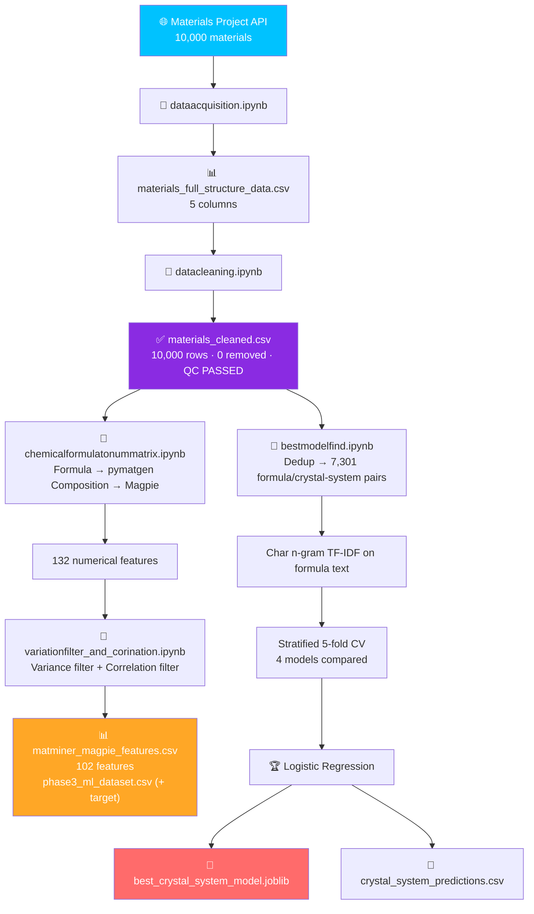

<div align="center">


<br/>

<a href="https://skillicons.dev">
  
</a>

<br/><br/>


<br/><br/>


<br/>

> 📚 Practical AI & Material Science notebooks for learning Python programming, data analysis, material properties, scientific visualization, Materials Project API, machine-learning-ready data processing, and regression modeling — plus a **featured project that predicts a material's crystal system directly from its chemical formula** (see below).


</div>


<div align="center">

# 🔷 Featured Project

## Prediction of Crystal System Directly from Chemical Formula


</div>

> 🎯 **Goal:** Given only a material's **chemical formula** (e.g. `CaMg(CO3)2`), predict which of the **7 crystal systems** it belongs to — Triclinic, Monoclinic, Orthorhombic, Tetragonal, Trigonal, Hexagonal or Cubic — *without* running DFT or knowing the atomic structure in advance.

<details open>
<summary><b>📖 Project Overview</b></summary>
<br>

A material's crystal system controls many of its physical properties, but it is normally only known after the material is synthesized and characterized (or after an expensive structure-prediction calculation). This project asks a simple question: **how much of the crystal system can be learned from the formula alone?**

The project covers the full machine-learning life-cycle:

1. 🌐 **Acquire** 10,000 materials (ID, formula, crystal system, space group, full structure) from the **Materials Project API**
2. 🧹 **Clean & validate** the data and produce a formal quality report
3. ⚛️ **Featurize** formulas into numbers (Matminer **Magpie** descriptors) and reduce them with variance and correlation filters
4. 🤖 **Compare models** with stratified cross-validation (Dummy baseline, Logistic Regression, Linear SVM, Naive Bayes)
5. 💾 **Save** the best model and use it to predict the crystal system of new formulas

</details>

<details open>
<summary><b>🔄 Project Pipeline</b></summary>
<br>



</details>

<details>
<summary><b>📓 Project Notebooks</b></summary>
<br>

| # | Notebook | Purpose | Key Result |
|:-:|----------|---------|------------|
| 1 | `dataacquisition.ipynb` | Query the Materials Project summary endpoint (`MPRester`) for `material_id`, `formula_pretty`, `symmetry`, `structure`; serialize each structure to JSON | 10,000 materials retrieved → `materials_full_structure_data.csv` |
| 2 | `datacleaning.ipynb` | Standardize column names, auto-detect key columns, check missing values, exact/ID duplicates, formula validity (`pymatgen.Composition`) and empty structures; write the formal report | 10,000 → 10,000 rows (0 removed), status **PASSED** → `materials_cleaned.csv` |
| 3 | `chemicalformulatonummatrix.ipynb` | Convert formulas to `Composition` objects and generate Matminer `ElementProperty` (Magpie) features | 132 numerical features, 0 NaN, 0 infinite values |
| 4 | `variationfilter_and_corination.ipynb` | Median-impute, `VarianceThreshold(0.01)`, then drop features with pairwise correlation > 0.95 | 132 → 128 → **102** features → `matminer_magpie_features.csv`, `phase3_ml_dataset.csv` |
| 5 | `bestmodelfind.ipynb` | Clean formula/target pairs, stratified split, 5-fold CV comparison of 4 models, learning curve, confusion matrix, save model & predictions | Best model: **Logistic Regression** → `best_crystal_system_model.joblib` |

</details>

<details>
<summary><b>🗂️ Project Datasets & Outputs</b></summary>
<br>

| File | Type | Shape | Description |
|------|------|-------|-------------|
| `raw_backup_materials_full_structure_data.csv` | 📥 Raw backup | 10,000 × 5 | `material_id`, `chemical_formula`, `crystal_system`, `space_group`, `full_structure` (JSON) |
| `materials_cleaned.csv` | ✅ Cleaned | 10,000 × 5 | Validated dataset used by every later notebook |
| `formal_data_cleaning_report.txt` | 📄 Report | — | Missing values, duplicates, formula validation, structure checks — **Status: PASSED** |
| `materials_with_magpie_features.csv` | 📤 Features | 10,000 × 133 | Formula + 132 Magpie features (before filtering) |
| `matminer_magpie_features.csv` | 📤 Features | 10,000 × 102 | Filtered feature matrix **X** (after variance + correlation filters) |
| `crystal_system_target.csv` | 🎯 Target | 10,000 × 1 | Crystal-system label **y** |
| `phase3_ml_dataset.csv` | 📤 ML-ready | 10,000 × 103 | 102 features + `crystal_system` target in one file |
| `crystal_system_predictions.csv` | 📊 Results | 1,461 × 3 | Test-set formula, actual and predicted crystal system |
| `best_crystal_system_model.joblib` | 🧠 Model | — | Trained scikit-learn `Pipeline` (TF-IDF + Logistic Regression) |

> 📌 The uploaded copies of these tables carry an `.xls` extension, but their content is plain **CSV** — read them with `pd.read_csv(...)`. The notebooks reference them with `.csv` names.

**Target class distribution (cleaned data, 10,000 materials):**

| Crystal System | Count | Share |
|----------------|------:|------:|
| Triclinic | 4,230 | 42.3% |
| Monoclinic | 2,601 | 26.0% |
| Trigonal | 1,027 | 10.3% |
| Orthorhombic | 911 | 9.1% |
| Cubic | 620 | 6.2% |
| Tetragonal | 540 | 5.4% |
| Hexagonal | 71 | 0.7% |

</details>

<details>
<summary><b>⚙️ Methodology</b></summary>
<br>

**Data preparation (`bestmodelfind.ipynb`)**
- Keep only `chemical_formula` (input) and `crystal_system` (target); strip whitespace and drop empty values
- Remove duplicate *(formula, crystal system)* pairs → **7,301 unique records**
- `train_test_split(test_size=0.20, stratify=y, random_state=42)` → **5,840 train / 1,461 test**

**Feature representation for the final model**
- The formula string is converted directly into numbers with a character-level **TF-IDF** vectorizer: `TfidfVectorizer(analyzer="char", ngram_range=(1, 3), lowercase=False, min_df=2, sublinear_tf=True)`
- Case is preserved so that element symbols such as `Co` (cobalt) and `CO` (carbon monoxide) stay distinguishable

**Model comparison** — `StratifiedKFold(n_splits=5, shuffle=True, random_state=42)` on the training set, scored with accuracy and macro precision / recall / F1:

| Model | CV Accuracy | CV Macro F1 |
|-------|:-----------:|:-----------:|
| **Logistic Regression** (`class_weight="balanced"`, `max_iter=1500`) | 54.32% | **43.78%** |
| Linear SVM (`class_weight="balanced"`) | 56.03% | 42.68% |
| Multinomial Naive Bayes (`alpha=0.5`) | 55.14% | 36.60% |
| Dummy Baseline (most frequent class) | 41.68% | 8.41% |

The best model is chosen by **macro F1** (not accuracy) because the classes are heavily imbalanced and every crystal system matters equally.

**Parallel route — composition-physics features (notebooks 3 & 4)**
- 132 Magpie statistics (min / max / range / mean / avg-dev / mode of properties such as atomic number, electronegativity, covalent radius, valence-electron counts and melting temperature)
- Variance filter (132 → 128) and correlation filter at 0.95 (128 → 102)
- The resulting `phase3_ml_dataset.csv` is ready for tree-based or other models (see *Future Work*)

</details>

<details open>
<summary><b>📈 Results (held-out test set — 1,461 materials)</b></summary>
<br>

| Metric | Score |
|--------|:-----:|
| Accuracy | **57.08%** |
| Macro Precision | 46.27% |
| Macro Recall | 53.14% |
| Macro F1 | 47.92% |
| *Majority-class baseline accuracy* | *41.68%* |

**Per-class performance:**

| Crystal System | Precision | Recall | F1 | Support |
|----------------|:---------:|:------:|:--:|:-------:|
| Cubic | 0.70 | 0.85 | **0.77** | 119 |
| Triclinic | 0.92 | 0.63 | **0.75** | 609 |
| Monoclinic | 0.54 | 0.51 | 0.52 | 347 |
| Trigonal | 0.40 | 0.62 | 0.48 | 139 |
| Tetragonal | 0.25 | 0.47 | 0.32 | 86 |
| Orthorhombic | 0.26 | 0.29 | 0.27 | 147 |
| Hexagonal | 0.18 | 0.36 | 0.24 | 14 |

**What the results say**
- ✅ The model beats the majority-class baseline by about **15 percentage points** of accuracy, so the formula does carry real signal about the crystal system
- ✅ **Cubic** and **Triclinic** are the best-recognized systems (F1 ≈ 0.75–0.77)
- ⚠️ **Hexagonal**, **Orthorhombic** and **Tetragonal** are hard — Hexagonal has only 71 examples in the full dataset (0.7%) and just 14 in the test set, so its score is noisy
- ⚠️ This is a **proof-of-concept baseline**, not a production-grade predictor

</details>

<details>
<summary><b>🔮 Use the Trained Model</b></summary>
<br>

```python
import joblib

model = joblib.load("best_crystal_system_model.joblib")

formulas = ["CaMg(CO3)2", "SiO2", "Al2O3"]
print(model.predict(formulas))
# ['Trigonal' 'Orthorhombic' 'Hexagonal']   ← output from the notebook run
```

The saved object is a complete `Pipeline` (vectorizer + classifier), so you can pass raw formula strings directly — no separate feature step is needed.

> ⚠️ Predictions are only as specific as the formula allows. Many compounds exist as several **polymorphs** with the same formula but different crystal systems (SiO₂ is a good example), so a formula-only model cannot always give the "right" answer for a specific sample. Always load the model with the same `scikit-learn` version used for training (1.7.2 in the notebook), or re-train it with `bestmodelfind.ipynb`.

</details>

<details>
<summary><b>🚧 Limitations & Future Work</b></summary>
<br>

**Limitations**
- Formula-only input cannot separate polymorphs; the data contains the same formula with different crystal systems
- Strong class imbalance (Triclinic 42% vs. Hexagonal 0.7%)
- The 10,000 materials are the first records returned by the API query, not a random or balanced sample
- Duplicate formula/system pairs were removed *before* the split, which is good practice, but the same formula can still appear in train and test under a different crystal system

**Future work**
- 🌲 Train **Random Forest / XGBoost / Gradient Boosting** on the 102 Magpie features in `phase3_ml_dataset.csv` and compare with the TF-IDF model (the features are already prepared in this repository)
- 🏗️ Add structure-based descriptors from the stored `full_structure` JSON (e.g. `SiteStatsFingerprint`, as used in Module 3 S07)
- ⚖️ Handle imbalance with resampling or class-specific thresholds; report per-class confidence
- 🔬 Extend the target from 7 crystal systems to **space group** (already collected in the dataset)
- 🧪 Use grouped cross-validation by composition family to test generalization to unseen chemistries

</details>

<details>
<summary><b>▶️ How to Reproduce</b></summary>
<br>

```bash
pip install mp-api pymatgen matminer scikit-learn pandas numpy matplotlib joblib python-dotenv
```

```text
1. dataacquisition.ipynb              → materials_full_structure_data.csv
2. datacleaning.ipynb                 → materials_cleaned.csv + formal_data_cleaning_report.txt
3. chemicalformulatonummatrix.ipynb   → 132 Magpie features
4. variationfilter_and_corination.ipynb → matminer_magpie_features.csv (102 features)
5. bestmodelfind.ipynb                → best_crystal_system_model.joblib + crystal_system_predictions.csv
```

🔐 **API key:** load the Materials Project key from an environment variable instead of writing it in the notebook (same `.env` pattern as Module 1 S07):

```python
import os
from dotenv import load_dotenv
load_dotenv()
API_KEY = os.getenv("MP_API_KEY")
```

> 📌 Notebooks 2–5 read `materials_project_cleaning/materials_cleaned.csv` by relative path (notebook 4 currently uses an absolute Windows path — change it to your own folder).

</details>


## 📂 Repository Structure

```text
📦 AI-Material-Science
 │
 ├── 📁 Module_1
 │   ├── 📓 Module 1 S01.ipynb
 │   ├── 📓 Module 1 S02.ipynb
 │   ├── 📓 Module 1 S03.ipynb
 │   ├── 📓 Module 1 S04.ipynb
 │   ├── 📓 Module 1 S05.ipynb
 │   ├── 📓 Module 1 S06.ipynb
 │   ├── 📓 Module 1 S07.ipynb
 │   └── 📓 Module 1 S08.ipynb
 │
 ├── 📁 Module_2
 │   │
 │   ├── 📓 Notebooks
 │   │   ├── 📓 Module 2 S01.ipynb
 │   │   ├── 📓 Module 2 S02.ipynb
 │   │   ├── 📓 Module 2 S03.ipynb
 │   │   ├── 📓 Module 2 S04.ipynb
 │   │   ├── 📓 Module 2 S05.ipynb
 │   │   ├── 📓 Module 2 S06.ipynb
 │   │   └── 📓 Module 2 S07.ipynb
 │   │
 │   └── 📊 Data
 │       │
 │       ├── 🔵 Perovskite Materials Data (S01-S04)
 │       │   ├── 📊 perovskites_data.csv
 │       │   ├── 📊 cleaned_materials_dataset.csv
 │       │   └── 📄 perovskites_report.html
 │       │
 │       └── 🟣 Heat Capacity Data (S05-S07)
 │           ├── 📊 cp_data_demo.csv (Input)
 │           └── 📊 cleaned_cp_dataset.csv (Output)
 │
 ├── 📁 Module_3
 │   │
 │   ├── 📓 Notebooks
 │   │   ├── 📓 Module 3 S01.ipynb
 │   │   ├── 📓 Module 3 S02.ipynb
 │   │   ├── 📓 Module 3 S03.ipynb
 │   │   ├── 📓 Module 3 S04.ipynb
 │   │   ├── 📓 Module 3 S05.ipynb
 │   │   ├── 📓 Module 3 S06.ipynb
 │   │   └── 📓 Module 3 S07.ipynb
 │   │
 │   └── 📊 Data
 │       │
 │       ├── 🟠 Elemental Features & ML Preparation (S01)
 │       │   ├── 📊 cleaned_cp_dataset.csv (Input)
 │       │   ├── 📊 elemental_feature_vectors.csv (Output)
 │       │   └── 📊 materials_feature_matrix.csv (Output)
 │       │
 │       ├── 🟠 CBFV Featurization, Magpie Properties (S03-S04)
 │       │   ├── 📊 cleaned_cp_dataset.csv (Input)
 │       │   └── 📊 cbfv_features.csv (Output — 4,564 rows × 133 cols)
 │       │
 │       ├── 🟠 Matminer Featurization, Magpie & Deml (S05)
 │       │   ├── 📊 cleaned_cp_dataset.csv (Input)
 │       │   ├── 📊 matminer_magpie_features.csv (Output — 4,564 rows × 133 cols)
 │       │   └── 📊 matminer_deml_features.csv (Output — 4,564 rows × 81 cols)
 │       │
 │       ├── 🟠 RFE + Random Forest Feature Selection (S06)
 │       │   ├── 📊 filtered_features_s20.csv (Input — 4,564 rows × 96 cols)
 │       │   ├── 📊 curated_features_s21.csv (Output — 4,564 rows × 21 cols)
 │       │   └── 📊 rfe_random_forest_importance_s21.csv (Output — top-20 importances)
 │       │
 │       └── 🟠 Structural Featurization via Materials Project (S07)
 │           ├── 📊 perovskites_data.csv (Input — 4,719 rows)
 │           └── 📊 structural_features_s22.csv (Output — SiteStatsFingerprint + Bag of Bonds)
 │
 ├── 📁 Module_4
 │   │
 │   ├── 📓 Notebooks
 │   │   ├── 📓 Module 4 S03.ipynb
 │   │   ├── 📓 Module 4 S04.ipynb
 │   │   ├── 📓 Module 4 S05.ipynb
 │   │   └── 📓 Module 4 S06.ipynb
 │   │
 │   └── 📊 Data
 │       │
 │       ├── 🔴 Standalone Linear vs. Ridge Re-run of the S01 Pipeline (S03)
 │       │   ├── 📊 cp_data_demo.csv (Input — same raw file as S01)
 │       │   └── 🖼️ ridge_alpha_sweep.png (Output — same plot as S01, regenerated)
 │       │
 │       ├── 🔴 Consolidated Linear / Ridge / Lasso / ElasticNet Notebook (S04)
 │       │   ├── 📊 cp_data_demo.csv (Input — same raw file as S01)
 │       │   ├── 🖼️ ridge_alpha_sweep.png (Output — regenerated by the embedded S01 cell)
 │       │   └── 📊 regularization_comparison_s26.csv (Output — same 4 × 3 table as S02)
 │       │
 │       ├── 🔴 Model Comparison Diagnostics: R² vs. RMSE and RMSE vs. MAE (S05)
 │       │   └── 📊 regularization_comparison_s26.csv (Input — table produced by S02 / S04; no file output)
 │       │
 │       └── 🔴 SVR (RBF Kernel) Baseline for Cp Prediction (S06)
 │           └── 📊 cp_data_demo.csv (Input — same raw file as S01; no file output)
 │
 ├── 📁 AI MAT SCI PROJECT
 │   │
 │   ├── 📓 Notebooks
 │   │   ├── 📓 dataacquisition.ipynb
 │   │   ├── 📓 datacleaning.ipynb
 │   │   ├── 📓 chemicalformulatonummatrix.ipynb
 │   │   ├── 📓 variationfilter_and_corination.ipynb
 │   │   └── 📓 bestmodelfind.ipynb
 │   │
 │   ├── 📊 Project Datasets
 │   │   ├── 📊 raw_backup_materials_full_structure_data.csv
 │   │   ├── 📊 materials_cleaned.csv
 │   │   ├── 📊 materials_with_magpie_features.csv
 │   │   ├── 📊 matminer_magpie_features.csv
 │   │   ├── 📊 crystal_system_target.csv
 │   │   ├── 📊 phase3_ml_dataset.csv
 │   │   ├── 📊 crystal_system_predictions.csv
 │   │   └── 📄 formal_data_cleaning_report.txt
 │   │
 │   └── 🧠 best_crystal_system_model.joblib
 │
 └── 📄 README.md
```


## 📘 Notebook Overview

<div align="center">


# 🔵 Module 1 — Python & Material Science Fundamentals


</div>

<details open>
<summary><b>📓 Module 1 S01.ipynb — 🏗️ Material Properties using Python</b></summary>
<br>


      


 Learn how to organize engineering material data using Python dictionaries.
</details>

<details>
<summary><b>📓 Module 1 S02.ipynb — 📊 Material Data Processing</b></summary>
<br>


     


 Understand numerical computing techniques used in Material Science.
</details>

<details>
<summary><b>📓 Module 1 S03.ipynb — 📈 Periodic Table Visualization</b></summary>
<br>


    


 Visualize engineering datasets with professional graphs.
</details>

<details>
<summary><b>📓 Module 1 S04.ipynb — 🔥 Thermal Conductivity Analysis</b></summary>
<br>


   


 Compare thermal properties of different engineering materials visually.
</details>

<details>
<summary><b>📓 Module 1 S05.ipynb — 📋 Multi-Material Dataset</b></summary>
<br>


   


 Build and analyze structured material datasets.
</details>

<details>
<summary><b>📓 Module 1 S06.ipynb — 🤖 AI Workflow & Git Basics</b></summary>
<br>


    


 Learn professional project management using Git with AI notebooks.
</details>

<details>
<summary><b>📓 Module 1 S07.ipynb — 🔑 Materials Project API Setup</b></summary>
<br>


    


 Learn how to configure and connect Python applications to the Materials Project API.
</details>

<details>
<summary><b>📓 Module 1 S08.ipynb — 🔥 Materials Data Retrieval and Visualization</b></summary>
<br>


   


 Learn how to retrieve materials data from the Materials Project API and visualize it using Python.
</details>

<br>

<div align="center">


# 🟣 Module 2 — Materials Data Engineering & Analysis


</div>

<details open>
<summary><b>📓 Module 2 S01.ipynb — 🔬 Materials Project Data Retrieval & Dataset Creation</b></summary>
<br>


         

The notebook retrieves materials matching the required chemical formulas from the Materials Project and extracts properties including **Material ID, formula, band gap, formation energy per atom, and volume**.

The retrieved datasets are converted into Pandas DataFrames, merged using `Material_ID`, and exported as `perovskites_data.csv`.


 Learn how to retrieve real materials-science data from the Materials Project API.
 Understand how to convert API results into structured Pandas DataFrames.
 Learn how to merge material-property datasets.
 Create a reusable CSV dataset for further AI and machine-learning analysis.

**📊 Datasets Used & Generated:**
- 📥 **Input:** Materials Project API (via MPRester)
- 📤 **Output:** `perovskites_data.csv` (merged material properties)

| Column             | Description                           |
| ------------------ | -------------------------------------- |
| `Material_ID`      | Materials Project material identifier |
| `Formula`          | Chemical formula                      |
| `Bandgap`          | Band gap value (eV)                   |
| `Formation_Energy` | Formation energy per atom (eV/atom)   |
| `Volume`           | Unit-cell volume (ų)                 |
</details>

<details>
<summary><b>📓 Module 2 S02.ipynb — 🧹 Materials Dataset Profiling & Missing Value Imputation</b></summary>
<br>


        

The notebook (Module 2, Session 02) loads the `perovskites_data.csv` dataset generated in Module 2 S01 and displays the first records, then creates an automated profiling report saved as `perovskites_report.html`.

```text
Mean Imputation  →  SimpleImputer(strategy="mean")
KNN Imputation   →  KNNImputer(n_neighbors=5)
```

Both approaches are applied to the `Bandgap` column.


 Inspect a scientific dataset automatically.
 Generate an HTML data-profiling report.
 Understand missing-value problems in material datasets.
 Apply Mean Imputation and KNN Imputation.
 Prepare datasets for future machine-learning workflows.

**📄 Report Generated:** `perovskites_report.html`
</details>

<details>
<summary><b>📓 Module 2 S03.ipynb — 🧪 Duplicate & Outlier Detection in Materials Data</b></summary>
<br>


      

The notebook (Module 2, Session 03) reloads the cleaned `perovskites_data.csv` dataset and inspects it for data-quality issues.

It first detects **duplicate entries** based on the `Formula` column using `df.duplicated()`, then visualizes the distribution of the `Bandgap` column with a **Seaborn boxplot** to spot anomalies visually. Finally, it applies the **IQR method** — computing Q1, Q3, and IQR — to mathematically flag statistical outliers in `Bandgap`.

```text
Duplicate Detection (Formula) → Boxplot (Bandgap) → IQR Bounds → Flagged Outliers
```


 Detect duplicate records in a materials dataset.
 Visualize numerical distributions using Seaborn boxplots.
 Understand and apply the IQR method for outlier detection.
 Combine visual and statistical techniques for data-quality assessment.
</details>

<details>
<summary><b>📓 Module 2 S04.ipynb — 📉 Domain-Driven Cleaning & Correlation Analysis</b></summary>
<br>


      

The notebook (Module 2, Session 04) reloads `perovskites_data.csv` and applies **domain-driven cleaning**, filtering out physically implausible band gap values (> 20 eV) to produce a cleaned `df_clean`. It then selects numeric columns (`Bandgap`, `Formation_Energy`, `Volume`) and generates a **correlation heatmap** with Seaborn. The finalized dataset is exported as `cleaned_materials_dataset.csv`.

```text
perovskites_data.csv 
  ↓ (S02-S03: Profiling, Imputation, Outlier Detection)
  ↓ (S04: Domain Cleaning - Bandgap ≤ 20 eV)
  ↓ (Correlation Analysis)
cleaned_materials_dataset.csv ✅
```


 Apply domain knowledge to filter physically implausible data.
 Build a cleaned, analysis-ready DataFrame (`df_clean`).
 Generate and interpret a correlation heatmap of materials properties.
 Understand relationships between band gap, formation energy, and volume.
 Export the finalized ML-ready dataset to `cleaned_materials_dataset.csv`.

**📊 Dataset Generated:** `cleaned_materials_dataset.csv` (4,719 rows, 5 columns)
</details>

<details>
<summary><b>📓 Module 2 S05.ipynb — 🌡️ Heat Capacity (Cp) Dataset Cleaning & Analysis</b></summary>
<br>


          

The notebook loads `cp_data_demo.csv` (4,577 rows) containing heat capacity measurements across different materials and temperatures. It standardizes column names to a **canonical schema** (`formula`, `T`, `Cp`), removes rows with missing values, filters physically implausible data (T < 0 or Cp < 0), and exports a cleaned dataset `cleaned_cp_dataset.csv` (4,564 rows).

Visualization and statistical analysis include **distribution histograms**, **Q-Q plots** for normality assessment, **multi-material temperature trends**, and **material-family classification** (Oxide, Carbide, etc.) to prepare data for predictive modeling.

```text
📥 cp_data_demo.csv (4,577 rows)
  ↓ (Schema Standardization: Formula→formula, Temperature→T, Heat_Capacity→Cp)
  ↓ (Remove NaN values)
  ↓ (Filter Physical Constraints: T ≥ 0, Cp ≥ 0)
  ↓ (Distribution Analysis & Histogram)
  ↓ (Q-Q Plot Normality Check)
  ↓ (Multi-material Temperature Trends)
  ↓ (Material Family Classification)
📤 cleaned_cp_dataset.csv (4,564 rows) ✅
```

**Data Quality Metrics:**
- Records removed: 13 (0.3% data loss)
- Schema standardization: Complete ✅
- Normality status: Q-Q plot verified
- ML-readiness: Confirmed ✅


 Load and standardize multi-material heat capacity datasets.
 Apply physical domain constraints to filter unphysical values.
 Perform statistical normality testing using Q-Q plots.
 Visualize temperature-dependent material properties.
 Classify materials by chemical family (Oxide, Carbide, etc.).
 Prepare thermal property datasets for machine-learning pipelines.

**📊 Datasets Used & Generated:**

| File | Type | Rows | Size | Description |
|------|------|------|------|-------------|
| `cp_data_demo.csv` | 📥 Input | 4,577 | 86.9 KB | Raw heat capacity dataset (demo) |
| `cleaned_cp_dataset.csv` | 📤 Output | 4,564 | 95.6 KB | Cleaned, standardized, validated dataset |

**Output Dataset Schema (`cleaned_cp_dataset.csv`):**

| Column    | Description                           | Units        |
| --------- | -------------------------------------- | ------------ |
| `formula` | Chemical formula of the material      | -            |
| `T`       | Temperature                           | Kelvin (K)   |
| `Cp`      | Heat capacity                         | J/mol·K      |

</details>

<details>
<summary><b>📓 Module 2 S06.ipynb — 📊 Heat Capacity Visualization & Material Family Classification</b></summary>
<br>


        

The notebook (Module 2, Session 06) loads the `cleaned_cp_dataset.csv` and performs multi-level visualization and classification analysis. It plots temperature-dependent heat capacity trends for selected materials using line plots with markers, then applies a **material family classification function** to categorize compounds into Oxides, Carbides, Nitrides, and Others based on chemical composition.

The classified data is then aggregated by family and temperature, computing mean and standard deviation statistics for comparative analysis across material families.

```text
cleaned_cp_dataset.csv
  ↓ (Load dataset)
  ↓ (Select sample materials - first 5 unique formulas)
  ↓ (Plot Cp vs T for each material)
  ↓ (Define family classification logic)
  ↓ (Apply classification to all materials)
  ↓ (Group by family & temperature)
  ↓ (Calculate mean & std statistics)
✅ Family-Classified Dataset with Statistics
```

**Classification Logic:**
```text
- 'O' in formula (no 'C', no 'N') → Oxide
- 'C' in formula → Carbide
- 'N' in formula → Nitride
- Others → Other
```


 Create publication-quality line plots of thermal properties.
 Develop and apply custom classification logic based on chemical composition.
 Use Pandas groupby() for multi-level data aggregation.
 Compute and interpret statistical measures (mean, std) by material family.
 Understand family-level thermal property trends in materials.

**📊 Key Operations:**

| Operation | Method | Output |
|-----------|--------|--------|
| Sample Selection | `df['formula'].unique()[:5]` | First 5 unique materials |
| Family Classification | `apply(classify_family)` | Oxide/Carbide/Nitride/Other |
| Filtering | `isin(['Oxide', 'Carbide', 'Nitride'])` | Only known families |
| Aggregation | `groupby(['family', 'T']).agg(['mean', 'std'])` | Family statistics by temperature |

</details>

<details>
<summary><b>📓 Module 2 S07.ipynb — 🎨 Advanced Multi-Family Heat Capacity Analysis with FacetGrid Visualization</b></summary>
<br>


          

The notebook (Module 2, Session 07) performs an **advanced multi-family materials analysis** using the `cleaned_cp_dataset.csv`. It implements an extended classification scheme detecting **8 chemical families** (Chlorides, Bromides, Fluorides, Oxides, Nitrides, Sulfides, Carbides, and Others) based on chemical composition analysis.

The data is thoroughly cleaned by standardizing column names, removing NaN values, and sorting by family, formula, and temperature. A **Seaborn FacetGrid** is then created to display Cp vs Temperature in a 3-column grid layout, with each subplot showing all materials within a specific chemical family, color-coded by formula for easy comparison.

This creates a **publication-ready multi-panel visualization** that reveals family-specific thermal property patterns and enables comparative analysis across chemically similar materials.

```text
📥 cleaned_cp_dataset.csv
  ↓ (Column Standardization: strip whitespace)
  ↓ (Validate Required Columns: formula, T, Cp)
  ↓ (Extended Family Classification)
  ↓   ├─ Chlorides (Cl)
  ↓   ├─ Bromides (Br)
  ↓   ├─ Fluorides (F)
  ↓   ├─ Oxides (O)
  ↓   ├─ Nitrides (N)
  ↓   ├─ Sulfides (S)
  ↓   ├─ Carbides (C)
  ↓   └─ Others (unclassified)
  ↓ (Remove NaN values)
  ↓ (Sort: family → formula → T)
  ↓ (Create FacetGrid: col="family", hue="formula")
  ↓ (Map line plots with markers)
  ↓ (Format labels, titles, legend)
📤 Multi-Family Comparative Visualization ✅
```

**Extended Classification Logic:**
```python
if "Cl" in formula:           return "Chlorides"
elif "Br" in formula:         return "Bromides"
elif "F" in formula:          return "Fluorides"
elif "O" in formula:          return "Oxides"
elif "N" in formula:          return "Nitrides"
elif "S" in formula:          return "Sulfides"
elif "C" in formula:          return "Carbides"
else:                         return "Other"
```


 Master advanced chemical family classification algorithms.
 Create multi-panel FacetGrid visualizations with Seaborn.
 Apply hue-based color coding for formula differentiation.
 Generate publication-quality multi-panel figures.
 Implement robust data validation and column standardization.
 Perform comparative materials analysis across chemical families.
 Understand how chemical composition influences thermal properties.

**📊 FacetGrid Configuration:**

| Parameter | Value | Purpose |
|-----------|-------|---------|
| `col="family"` | Organize by chemical family | Separate panels per family |
| `hue="formula"` | Color by material formula | Distinguish materials in each family |
| `col_wrap=3` | 3 columns per row | Optimal layout for comparison |
| `height=5, aspect=1.2` | Panel dimensions | Professional spacing |
| `palette="tab10"` | Color scheme | Clear color differentiation |
| `marker="o", linewidth=2` | Plot style | Visibility and clarity |

**Visualization Output:**
- **Subplots:** One for each detected chemical family
- **Series per Panel:** One line per material formula (color-coded)
- **X-axis:** Temperature (K)
- **Y-axis:** Heat Capacity Cp (J/mol·K)
- **Legend:** Material formulas by color
- **Titles:** "Chemical Family: {family_name}" for each subplot

</details>

<br>

<div align="center">


# 🟠 Module 3 — Feature Engineering & Machine Learning Preparation


</div>

<details open>
<summary><b>📓 Module 3 S01.ipynb — ⚛️ Elemental Property Extraction & Statistical Aggregation</b></summary>
<br>


       

The notebook (Module 3, Session 01) introduces **elemental property extraction** from chemical formulas and performs **statistical aggregation** on these properties. Starting fresh with Module 3, this session bridges the cleaned materials datasets (from Module 2) into machine-learning-ready feature vectors.

It loads a dataset of chemical formulas (Fe₂O₃, Al₂O₃, TiO₂, SiO₂) and creates a **periodic table mapping** using electronegativity values as a model elemental property. The workflow demonstrates how to:

1. Parse chemical formulas from a DataFrame
2. Map individual elements to their periodic table properties
3. Extract and aggregate elemental data (mean, sum, min, max) per material
4. Prepare feature vectors for machine learning pipelines
5. Generate compositional descriptors for predictive modeling

This foundational Module 3 session bridges materials dataset cleaning (Module 2, S05-S07) and downstream machine-learning workflows, enabling the creation of **elemental feature vectors** that capture compositional information for advanced AI-driven materials discovery.

```text
📥 Chemical Formulas Dataset
  ↓ (Fe2O3, Al2O3, TiO2, SiO2)
  ↓ (Initialize Periodic Table Dictionary)
  ↓ (Electronegativity Map)
  ↓ (Formula Parsing & Element Extraction)
  ↓ (Statistical Aggregation by Element)
  ↓   ├─ Mean electronegativity
  ↓   ├─ Max electronegativity
  ↓   ├─ Min electronegativity
  ↓   └─ Sum electronegativity
📤 Elemental Feature Vectors ✅
```

**Elemental Property Dictionary:**
```python
electronegativity_map = {
    'Fe': 1.83,  # Iron
    'Al': 1.61,  # Aluminum
    'Ti': 1.54,  # Titanium
    'Si': 1.90,  # Silicon
    'O': 3.44    # Oxygen
}
```

**Example Data Processing:**
- Formula: Fe₂O₃ → Elements: {Fe: 2, O: 3}
- Extract properties: {Fe: 1.83, O: 3.44}
- Aggregate: mean(1.83, 3.44) = 2.635, max = 3.44, min = 1.83


 Understand the role of elemental properties in materials science.
 Parse chemical formulas and extract individual elements.
 Create and utilize periodic table property mappings.
 Perform statistical aggregation of elemental properties.
 Generate elemental feature vectors for ML pipelines.
 Prepare compositional descriptors for materials prediction.
 Bridge materials data cleaning and machine-learning workflows.

**📊 Workflow Pipeline:**

| Step | Operation | Input | Output |
|------|-----------|-------|--------|
| 1 | Load formulas | CSV DataFrame | Formula column |
| 2 | Create periodic map | Element symbols | Property dictionary |
| 3 | Parse formulas | Formula strings | Element-count dict |
| 4 | Extract properties | Element mapping | Property values |
| 5 | Aggregate stats | Property values | Mean/Max/Min/Sum |
| 6 | Create features | Aggregated stats | Feature DataFrame |

**Key Concepts:**
- **Periodic Table Mapping:** Dictionary lookup for elemental properties
- **Formula Parsing:** Extract elements and stoichiometry from compound formulas
- **Aggregation Functions:** Statistical measures (mean, max, min, sum) across elements
- **Feature Engineering:** Create ML-ready descriptors from composition
- **Scalability:** Automated processing of large materials datasets

This session prepares the foundation for **machine-learning feature engineering** in future modules, where elemental properties become predictive features for materials discovery and property prediction.

</details>

<details>
<summary><b>📓 Module 3 S02.ipynb — 🤖 AI-Powered Strength Prediction with Linear Regression</b></summary>
<br>


      

This notebook (Module 3, Session 02) trains a **`scikit-learn` Linear Regression model** on historical lab data to predict material strength from two composition/process parameters, then lets you plug in a new "virtual" material recipe and see the AI's predicted strength plotted against the training data.

**Workflow:**
1. Build a small historical lab dataset: `X_train` = (Carbon Percentage, Printing Temperature) pairs, `y_train` = measured strength (MPa) from past lab tests
2. Fit a `LinearRegression()` model from `sklearn.linear_model` on `X_train` / `y_train`
3. Define interactive input parameters — `my_carbon_percentage` and `my_printing_temp` — that represent a new, untested material recipe
4. Run the trained model's `.predict()` on this new recipe to estimate its strength
5. Visualize the design space with `matplotlib`: past lab experiments as blue dots, the AI's predicted "virtual" material as a red star

```text
📥 Historical Lab Data
  ↓ (X_train: Carbon % , Printing Temp)
  ↓ (y_train: Measured Strength, MPa)
  ↓ (sklearn LinearRegression().fit())
🧠 Trained AI Model
  ↓ (New recipe: Carbon % = 0.25, Temp = 225°C)
  ↓ (ai_model.predict())
📤 Predicted Strength ≈ 394.00 MPa ✅
  ↓ (matplotlib scatter: Lab Data vs AI Prediction)
📊 Design Space Visualization
```

**Training Data (Historical Lab Experiments):**

| Carbon % | Printing Temp (°C) | Measured Strength (MPa) |
|:--------:|:-------------------:|:-------------------------:|
| 0.1 | 200 | 300 |
| 0.2 | 210 | 340 |
| 0.4 | 230 | 410 |
| 0.5 | 240 | 450 |
| 0.6 | 250 | 490 |
| 0.8 | 270 | 560 |

**Interactive Prediction Example:**
- Input recipe: Carbon % = `0.25`, Printing Temp = `225°C`
- Model output: **Predicted Strength ≈ 394.00 MPa**
- Plotted as a red star against the blue historical data points on a Carbon % vs. Strength (MPa) scatter plot


 Understand how a Linear Regression model learns from historical lab (composition/process → property) data.
 Train a `scikit-learn` model on multi-feature materials data (`X_train`, `y_train`).
 Use a trained model to predict material strength for a new, untested recipe.
 Interactively vary input parameters to explore the model's design space.
 Visualize AI predictions alongside experimental data with `matplotlib`.

**📊 Workflow Pipeline:**

| Step | Operation | Input | Output |
|------|-----------|-------|--------|
| 1 | Build training set | Lab measurements | `X_train`, `y_train` arrays |
| 2 | Train model | `LinearRegression()` | Fitted `ai_model` |
| 3 | Define new recipe | Carbon %, Temp | `new_material` array |
| 4 | Predict strength | Fitted model + recipe | Predicted MPa value |
| 5 | Visualize | Train data + prediction | Scatter plot design space |

**Key Concepts:**
- **Materials Informatics:** Using ML to map composition/process parameters to material properties
- **Linear Regression:** Fitting a linear model between input features and a continuous target (strength)
- **Feature Vector:** Representing a material recipe as `[carbon_percentage, printing_temp]`
- **Interactive "What-If" Testing:** Predicting properties for recipes that were never physically tested
- **Model Visualization:** Overlaying predictions on real experimental data to sanity-check the model

This session gives a first hands-on taste of **predictive materials modeling**, previewing the machine-learning workflows that Module 4 builds on with regression, classification, and more advanced models trained on materials data.

</details>

<details>
<summary><b>📓 Module 3 S03.ipynb — 🧪 CBFV Featurization (Magpie Elemental Properties)</b></summary>
<br>


      

This notebook (Module 3, Session 03) installs and uses the **CBFV** (Composition-Based Feature Vector) library to convert chemical formulas into full compositional descriptor matrices using **Magpie** elemental properties.

**Workflow:**
1. `pip install CBFV` and import `composition` from the `CBFV` package
2. Load `cleaned_cp_dataset.csv` (formula, T, Cp)
3. Rename the target column (`Cp` → `target`) so CBFV recognizes the schema it expects
4. Call `composition.generate_features(df, elem_prop='magpie', drop_duplicates=False, extend_features=True)` to build the feature matrix
5. Audit the output for all-zero columns and NaN values
6. Export the validated matrix to `cbfv_features.csv`

```text
📥 cleaned_cp_dataset.csv (4,564 rows)
  ↓ (Rename Cp → target)
  ↓ (CBFV composition.generate_features, elem_prop='magpie')
  ↓ (Zero-feature & NaN audit)
📤 cbfv_features.csv ✅ — 4,564 rows × 133 columns
```


 Install and apply the CBFV library to generate compositional feature vectors.
 Standardize a dataset's schema (`formula`/`target`) for CBFV compatibility.
 Generate a 133-column Magpie-based descriptor matrix from 4,564 formulas.
 Audit a feature matrix for all-zero and missing (NaN) columns before export.

**Output file inspected:** `cbfv_features.csv` — **4,564 rows × 133 columns**, no missing values, columns following the `avg_*`, `dev_*`, `range_*`, `max_*`, `min_*`, `mode_*` naming convention for each Magpie elemental property, plus a trailing `T` (temperature) column.

</details>

<details>
<summary><b>📓 Module 3 S04.ipynb — 🔍 CBFV Feature Matrix Inspection & Cross-Dataset Troubleshooting</b></summary>
<br>


     

This notebook (Module 3, Session 04) reviews the 133-column CBFV Magpie feature matrix produced in S03 and then attempts to extend the same CBFV pipeline to a **second dataset** using different source column names (`composition`, `band_gap`).

**Workflow:**
1. Re-display the head of the CBFV feature matrix generated in S03 — 133 columns (`avg_*` … `mode_*` plus `T`), confirmed shape `(4564, 133)`
2. Attempt to rename a second dataset's columns: `composition` → `formula`, `band_gap` → `target`
3. Call `composition.generate_features(df, elem_prop='magpie', drop_duplicates=False, sum_feat=False)` on that dataset
4. The call raises a `KeyError: 'formula'` inside CBFV's `generate_features`, because the source dataset did not actually contain a `composition`/`band_gap` pair matching the expected schema

```text
📥 cbfv_features.csv (from S03) → head()/shape review ✅
📥 Second dataset (composition, band_gap columns)
  ↓ (Attempted rename → formula, target)
  ↓ (CBFV composition.generate_features)
❌ KeyError: 'formula' — schema mismatch, featurization failed
```


 Re-verify the structure and integrity of a previously exported CBFV feature matrix.
 Practice applying CBFV featurization to a new dataset via column renaming.
 Diagnose a `KeyError` raised when the expected `formula`/`target` columns are missing.
 Reinforce the importance of schema validation before running featurization pipelines.

> ⚠️ **Note:** This session ends with an unresolved `KeyError`, captured as-is for troubleshooting reference. The rename step did not produce a valid `formula` column, so featurization on the second dataset did not complete.

</details>

<details>
<summary><b>📓 Module 3 S05.ipynb — ⚖️ Matminer Featurization: Magpie vs. Deml Benchmark</b></summary>
<br>


      

This notebook (Module 3, Session 05) uses **Matminer's `ElementProperty` featurizer** on top of **Pymatgen `Composition`** objects to generate two independent compositional descriptor sets — **Magpie** and **Deml** — and benchmarks them against each other.

**Workflow:**
1. Load `cleaned_cp_dataset.csv` (4,564 rows) and validate the `formula` column exists
2. Convert each formula string into a Pymatgen `Composition` object
3. Featurize with `ElementProperty.from_preset('magpie')`, timing the run
4. Featurize with `ElementProperty.from_preset('deml')`, timing the run
5. Compare feature counts and runtimes between the two presets
6. Export both descriptor sets to CSV and preview the first 5 rows of each

```text
📥 cleaned_cp_dataset.csv (4,564 rows)
  ↓ (formula → pymatgen Composition)
  ↓ (Matminer ElementProperty — magpie preset)   → matminer_magpie_features.csv (132 features, 536.71s)
  ↓ (Matminer ElementProperty — deml preset)     → matminer_deml_features.csv (80 features, 532.90s)
📤 Two benchmarked compositional feature sets ✅
```


 Convert chemical formulas into Pymatgen `Composition` objects for featurization.
 Use Matminer's `ElementProperty` featurizer with the Magpie and Deml presets.
 Benchmark featurization runtime and output dimensionality across presets.
 Export multiple ML-ready descriptor sets for downstream model selection.

**Benchmark Results:**

| Preset | Features Generated | Output Shape | Time |
|--------|--------------------|---------------|------|
| Magpie | 132 | (4,564, 133) | 536.71 s |
| Deml   | 80  | (4,564, 81)  | 532.90 s |

> Runtimes are essentially identical — the runtime is dominated by per-row `Composition` handling rather than the number of features — so the main difference between the presets is dimensionality (132 vs. 80 features), not speed.

</details>

<details>
<summary><b>📓 Module 3 S06.ipynb — 🧮 Feature Selection: RFE (Ridge) + Random Forest Importance</b></summary>
<br>


      

This notebook (Module 3, Session 06) takes a wide Magpie-based feature matrix and narrows it down to a compact, high-signal feature set using two complementary feature-selection techniques: **Recursive Feature Elimination (RFE)** with a `Ridge` estimator, followed by a **Random Forest** importance ranking on the selected subset.

**Workflow:**
1. Load `filtered_features_s20.csv` (**4,564 rows × 96 columns**) and set the regression target to `MagpieData mean GSbandgap`
2. Drop target-leakage columns (`MagpieData minimum/maximum/mean/mode GSbandgap`) and the `formula` column from the feature matrix `X`
3. Coerce all remaining columns to numeric, replace `inf`/`-inf` with `NaN`, drop fully-empty columns, and **median-impute** any remaining missing values → cleaned `X` (**4,564 rows × 92 columns**)
4. Run **`RFE(estimator=Ridge(alpha=1.0), n_features_to_select=20, step=1)`** to select the top 20 predictive features
5. Fit a **`RandomForestRegressor(n_estimators=100, random_state=42)`** on the 20 RFE-selected features to rank them by importance
6. Plot a `matplotlib` bar chart of Random Forest importances (sorted, 90° rotated feature labels)
7. Assemble a curated dataset (`formula` if present + target + top 20 features) and export it, along with the importance ranking, to CSV

```text
📥 filtered_features_s20.csv (4,564 rows × 96 cols)
  ↓ (Drop target-leakage cols + formula)
  ↓ (Numeric coercion, inf→NaN, drop empty cols, median impute)
  ↓ X: 4,564 rows × 92 cols
  ↓ (RFE, estimator=Ridge, n_features_to_select=20)
  ↓ Top 20 features selected
  ↓ (RandomForestRegressor on top-20 subset)
  ↓ Feature importance ranking + bar chart
📤 curated_features_s21.csv (4,564 rows × 21 cols) ✅
📤 rfe_random_forest_importance_s21.csv (top-20 importances) ✅
```

**Top 5 Features by Random Forest Importance:**

| Rank | Feature | Importance |
|:----:|---------|:----------:|
| 1 | `MagpieData mean Row` | 0.4246 |
| 2 | `MagpieData maximum Electronegativity` | 0.1821 |
| 3 | `MagpieData mean NpUnfilled` | 0.0946 |
| 4 | `MagpieData avg_dev NpUnfilled` | 0.0636 |
| 5 | `MagpieData mode Electronegativity` | 0.0601 |


 Clean a wide feature matrix: numeric coercion, infinity handling, empty-column removal, median imputation.
 Guard against target leakage by removing columns derived from the prediction target.
 Apply `sklearn`'s `RFE` with a `Ridge` estimator to select a fixed number of top features.
 Rank selected features with a `RandomForestRegressor`'s `feature_importances_`.
 Visualize ranked feature importances with a sorted `matplotlib` bar chart.
 Produce a compact, curated, ML-ready feature set for downstream model training.

**📊 Datasets Used & Generated:**

| File | Type | Rows | Columns | Description |
|------|------|------|---------|--------------|
| `filtered_features_s20.csv` | 📥 Input | 4,564 | 96 | Wide Magpie-based feature matrix carried in from the prior feature-engineering stage |
| `curated_features_s21.csv` | 📤 Output | 4,564 | 21 | Target (`MagpieData mean GSbandgap`) + top-20 RFE features (`formula` also kept if present) |
| `rfe_random_forest_importance_s21.csv` | 📤 Output | 20 | 2 | Feature name + Random Forest importance score, sorted descending |

</details>

<details>
<summary><b>📓 Module 3 S07.ipynb — 🏗️ Structural Featurization via Materials Project (SiteStatsFingerprint & Bag of Bonds)</b></summary>
<br>


       

This notebook (Module 3, Session 07) moves beyond purely **compositional** descriptors (Module 3 S01/S03/S05) into **structural** featurization — it pulls actual crystal structures for the perovskite dataset from the Materials Project and derives two matminer structure-based descriptor sets: `SiteStatsFingerprint` and `BagofBonds`.

**Workflow:**
1. Load `perovskites_data.csv` (**4,719 rows**) and validate that a `Material_ID` column exists
2. Clean/deduplicate `Material_ID` values (`astype(str).str.strip()`, `unique()`) → 4,719 unique IDs
3. Connect to the Materials Project via `MPRester` (API key) and batch-download `structure` objects for every `material_id`
4. Map the retrieved `pymatgen` `Structure` objects back onto the DataFrame and drop any rows with a missing structure
5. Generate **`SiteStatsFingerprint.from_preset("CoordinationNumber_ward-prb-2017")`** features (coordination-number statistics per structure)
6. Fit and apply matminer's **`BagofBonds`** featurizer (`bob.fit()` learns the bond-type vocabulary across the dataset, then `featurize_dataframe()` extracts per-structure bond-length descriptors)
7. Concatenate the `SiteStatsFingerprint` and `BagofBonds` feature blocks, drop the raw `structure` column and any fully-empty columns
8. Export the combined descriptor matrix to `structural_features_s22.csv`

```text
📥 perovskites_data.csv (4,719 rows: Material_ID, Formula, Bandgap, Formation_Energy, Volume)
  ↓ (Clean Material_ID → 4,719 unique IDs)
  ↓ (MPRester batch download → 4,719/4,719 structures retrieved, 0 missing)
  ↓ (SiteStatsFingerprint: CoordinationNumber_ward-prb-2017 preset)   → 5 coordination-number features
  ↓ (BagofBonds: fit() bond vocabulary → featurize_dataframe())       → per-structure bond-length features
  ↓ (Concatenate SSF + BoB, drop structure col, drop empty cols)
📤 structural_features_s22.csv ✅
```


 Retrieve full crystal `Structure` objects from the Materials Project by `material_id`, not just scalar properties.
 Understand the difference between compositional descriptors (formula-only) and structural descriptors (geometry-aware).
 Apply matminer's `SiteStatsFingerprint` to summarize per-site coordination environments.
 Apply matminer's `BagofBonds` featurizer, including the `fit()`/`featurize_dataframe()` pattern needed to learn a shared bond vocabulary.
 Combine multiple structure-based feature blocks into a single descriptor matrix and clean it for export.

**📊 Datasets Used & Generated:**

| File | Type | Rows | Description |
|------|------|------|-------------|
| `perovskites_data.csv` | 📥 Input | 4,719 | Material_ID, Formula, Bandgap, Formation_Energy, Volume |
| `structural_features_s22.csv` | 📤 Output | 4,719 | Combined `SiteStatsFingerprint` (5 coordination-number features) + `BagofBonds` (per-structure bond-length features) |

> 🔐 **Security note:** The notebook as written hardcodes a Materials Project `API_KEY` string directly in the source cell. Before sharing or committing this notebook, replace the hardcoded key with an environment variable (see the `.env` / `python-dotenv` pattern from **Module 1 S07**) and rotate/regenerate the key if it has already been exposed.

</details>

<br>

<div align="center">


# 🔴 Module 4 — Machine Learning for Materials


</div>

<details>
<summary><b>📓 Module 4 S03.ipynb — 🔁 Standalone Linear vs. Ridge Pipeline (S01 Code Re-run)</b></summary>
<br>


       

This notebook (Module 4, Session 03) is a **single, self-contained code cell** that runs the complete S01 pipeline from raw `cp_data_demo.csv` to the saved α-sweep plot — there are no markdown cells and no new modelling step. The code matches the S01 pipeline described above (the only difference is whitespace), and it produces **exactly the same numbers and the same `ridge_alpha_sweep.png`**. It is the cell that S04 and S06 embed to rebuild `X_train`, `X_test`, `y_train`, `y_test`, `lr` and `best_alpha` in memory.

**Workflow (same as S01):**
1. Load `cp_data_demo.csv` and drop rows with a missing `Formula`, `Temperature` or `Heat_Capacity`
2. Featurize formulas (regex parser + 40-element mass / electronegativity tables) into `n_atoms`, `n_elements`, `mean_mass`, `mean_EN` and `frac_<element>`; add `Temperature` as a feature
3. Split 80/20 with `GroupShuffleSplit(random_state=42)`, grouped by `Formula`
4. Fit `make_pipeline(StandardScaler(), LinearRegression())` as the baseline
5. Sweep 50 α values (`np.logspace(-2, 2, 50)`) with `make_pipeline(StandardScaler(), Ridge(alpha=α))`
6. Plot test R² vs. α (log axis) and save it as `ridge_alpha_sweep.png` (300 dpi)

```text
📥 cp_data_demo.csv
  ↓ (dropna → formula featurization → GroupShuffleSplit 80/20 by Formula)
  ↓ Baseline: StandardScaler + LinearRegression      → Train R² 0.910 | Test R² 0.924
  ↓ Ridge α sweep: np.logspace(-2, 2, 50)            → best α = 100.00 | Test R² 0.928
📤 ridge_alpha_sweep.png ✅ (regenerated)
```

**Results (identical to S01):**

| Model | Train R² | Test R² |
|-------|:--------:|:-------:|
| Linear Regression (baseline) | 0.910 | 0.924 |
| Ridge Regression (best α = 100.00) | — | **0.928** |

> 💡 **Reading the result:** The identical outputs in S03, S04 and S06 confirm the experiment is **reproducible** — the fixed `random_state=42` and the formula-grouped split give the same train/test materials and the same metrics on every run. The S01 caveats carry over unchanged: the best α (100.00) is at the upper edge of the sweep and is picked on the test set, so the 0.928 is slightly optimistic. The notebook also ends with an empty trailing cell that can be deleted.


 Reproduce a complete regression experiment (featurization → grouped split → baseline → α sweep → plot) in one self-contained cell.
 Verify reproducibility: the same seed and grouped split return the same Train R² 0.910 / Test R² 0.924 and best α = 100.00 (Test R² 0.928).
 Understand which in-memory objects (`X_train`, `X_test`, `y_train`, `y_test`, `lr`, `best_alpha`) later sessions depend on.

**📊 Datasets Used & Generated:**

| File | Type | Description |
|------|------|-------------|
| `cp_data_demo.csv` | 📥 Input | Raw heat capacity dataset (`Formula`, `Temperature`, `Heat_Capacity`), same file as S01 |
| `ridge_alpha_sweep.png` | 📤 Output | Alpha-sweep plot (300 dpi), regenerated — same content as the S01 output |

</details>

<details>
<summary><b>📓 Module 4 S04.ipynb — 🧩 Consolidated Regularization Notebook (S01 + S02 in One File)</b></summary>
<br>


       

This notebook (Module 4, Session 04) packs the **S01 pipeline and the S02 regularization comparison into one runnable notebook** (8 code cells, no markdown). Cell 1 is the S01 code (featurization, grouped split, Linear baseline, Ridge α sweep); the remaining cells are the S02 workflow. Because S01's objects are created in the cell directly above, the guard cell passes without any manual re-run, and the notebook reproduces the **same Lasso / ElasticNet settings and the same 4-model table** as S02.

> 🔗 **Cell layout:** (1) S01 pipeline → (2) imports for `Lasso`, `ElasticNet`, `LassoCV`, `ElasticNetCV` and the metrics → (3) guard cell checking `X_train`, `X_test`, `y_train`, `y_test`, `lr`, `best_alpha` (its error message says "re-run the S25 cells", i.e. S01) → (4) `LassoCV` → (5) `ElasticNetCV` → (6) `evaluate_model()` → (7) 4-model table + CSV export → (8) empty trailing cell.

**Workflow:**
1. Run the S01 pipeline: featurization → `GroupShuffleSplit` 80/20 by `Formula` → Linear baseline (Train R² 0.910, Test R² 0.924) → Ridge α sweep (best α = 100.00, Test R² 0.928) → `ridge_alpha_sweep.png`
2. Import `Lasso`, `ElasticNet`, `LassoCV`, `ElasticNetCV` and `r2_score`, `mean_squared_error`, `mean_absolute_error`
3. Run the guard cell that raises a `NameError` if any S01 object is missing
4. Train **`LassoCV(cv=5, random_state=42, max_iter=10000)`** → α = **7.5731**, **42 features forced to exactly 0** (sample: `frac_Al`, `frac_B`, `frac_Ba`, `frac_Be`, `frac_Br`)
5. Train **`ElasticNetCV(l1_ratio=[0.1, 0.5, 0.7, 0.9, 0.95, 1.0], cv=5)`** → α = **7.5731**, `l1_ratio = 1.0`
6. Score all four models with `evaluate_model()` (R², RMSE, MAE) on the held-out materials and save `regularization_comparison_s26.csv`

```text
📥 cp_data_demo.csv
  ↓ [cell 1] S01 pipeline            → lr, best_alpha, X_train/X_test/y_train/y_test, ridge_alpha_sweep.png
  ↓ [cell 3] guard cell              → all objects present ✅
  ↓ [cell 4] LassoCV(cv=5)           → α = 7.5731, 42 features zeroed
  ↓ [cell 5] ElasticNetCV(grid)      → α = 7.5731, l1_ratio = 1.0
  ↓ [cell 7] Ridge(alpha=best_alpha) → refit, then 4-model table
📤 regularization_comparison_s26.csv ✅ (4 models × 3 metrics)
```

**Results (identical to S02):**

| Model | R² | RMSE (J/mol·K) | MAE (J/mol·K) |
|-------|:--:|:--------------:|:-------------:|
| **Unregularized LR** | **0.9238** | **21.826** | **15.009** |
| Ridge (L2) | 0.9180 | 22.648 | 15.158 |
| Lasso (L1) | 0.8990 | 25.129 | 17.208 |
| ElasticNet | 0.8990 | 25.129 | 17.208 |

> 💡 **Reading the result:** The numbers match S02 exactly, so the two notebooks are interchangeable for this experiment — S04 is simply the "run everything top to bottom" version. All three S02 caveats still apply: **(1)** the table's Ridge (0.918) is refit on *unscaled* features (`Ridge(alpha=best_alpha)`), so it is not comparable with the scaled-pipeline Ridge from the α sweep (0.928); **(2)** ElasticNet chose `l1_ratio = 1.0`, i.e. it *is* Lasso, so rows 3 and 4 are one model; **(3)** Lasso / ElasticNet are also fitted on unscaled features, which likely explains the 42 zeroed `frac_*` columns. Wrapping the three models in `make_pipeline(StandardScaler(), ...)` and re-running is the recommended fix.


 Combine a multi-session experiment into one notebook that runs top to bottom without hidden dependencies.
 Use a guard cell to confirm that the objects a later step needs actually exist.
 Reproduce the 4-model regularization table (Linear, Ridge, Lasso, ElasticNet) and confirm it matches S02.
 Spot the scaled-vs-unscaled and ElasticNet-collapses-to-Lasso pitfalls when comparing models.

**📊 Datasets Used & Generated:**

| File | Type | Description |
|------|------|-------------|
| `cp_data_demo.csv` | 📥 Input | Raw heat capacity dataset (`Formula`, `Temperature`, `Heat_Capacity`), same file as S01 |
| `ridge_alpha_sweep.png` | 📤 Output | Regenerated by the embedded S01 cell |
| `regularization_comparison_s26.csv` | 📤 Output | 4 rows (Unregularized LR, Ridge (L2), Lasso (L1), ElasticNet) × 3 columns (`R²`, `RMSE`, `MAE`); first column is the unnamed model-name index |

</details>

<details>
<summary><b>📓 Module 4 S05.ipynb — 📊 Model Comparison Diagnostics (R² vs. RMSE, RMSE vs. MAE)</b></summary>
<br>


     

This notebook (Module 4, Session 05) turns the 4-model comparison table from S02 / S04 into **two diagnostic figures**. It does **not** train any model: it reads `regularization_comparison_s26.csv` and visualizes the stored **R², RMSE and MAE** values. (Its title cell reads "Session S27: Diagnostics: Parity & Residual Plots"; the figures actually produced are the metric-comparison plots below.)

**Workflow:**
1. Import `matplotlib`, `seaborn`, `numpy`, `pandas`
2. Load `regularization_comparison_s26.csv` and preview it (the model names arrive in an `Unnamed: 0` column because the file was saved with an unnamed index)
3. Rebuild the same 4 × 3 table as a DataFrame with `Model`, `R2`, `RMSE`, `MAE` columns (the values are typed in from the S02 / S04 results)
4. Draw a 14 × 6 figure with two panels:
   - **Left — R² vs. RMSE scatter:** one annotated point per model, grid on
   - **Right — RMSE vs. MAE grouped bars:** two bars per model, x-labels rotated 25°
5. Display the figure with `plt.show()` (no image file is saved)

```text
📥 regularization_comparison_s26.csv (4 models × R², RMSE, MAE)
  ↓ (load + preview → Unnamed: 0 = model names)
  ↓ (rebuild DataFrame: Model | R2 | RMSE | MAE)
  ↓ Panel 1: scatter  R² (x) vs. RMSE (y), annotated per model
  ↓ Panel 2: grouped bars  RMSE vs. MAE per model
📤 Two-panel diagnostic figure (displayed, not saved) ✅
```

**Data plotted:**

| Model | R² | RMSE (J/mol·K) | MAE (J/mol·K) |
|-------|:--:|:--------------:|:-------------:|
| Unregularized LR | 0.9238 | 21.826 | 15.009 |
| Ridge (L2) | 0.9180 | 22.648 | 15.158 |
| Lasso (L1) | 0.8990 | 25.129 | 17.208 |
| ElasticNet | 0.8990 | 25.129 | 17.208 |

> 💡 **Reading the plots:** The scatter shows the expected inverse relationship — higher R² goes with lower RMSE — and puts **Unregularized LR in the best corner** (highest R², lowest RMSE and MAE). **Lasso and ElasticNet land on exactly the same point**, so the scatter shows only three visible markers for four models (ElasticNet collapsed to Lasso with `l1_ratio = 1.0`). In the bar panel, MAE is lower than RMSE for every model, which is normal because RMSE weights large errors more heavily. Three small points worth knowing: **(1)** the title promises *parity and residual* plots, but those need per-sample predictions (`y_test` vs. `y_pred`), which this notebook does not have — it compares summary metrics only; **(2)** the table is retyped by hand even though the CSV was just loaded, so it will not update if S02 / S04 are re-run (reading it with `pd.read_csv('regularization_comparison_s26.csv', index_col=0)` avoids that); **(3)** `seaborn` is imported but not used.


 Visualize a model-comparison table with a two-panel `matplotlib` figure (`plt.subplots(1, 2)`).
 Read the R²–RMSE trade-off and compare RMSE against MAE across models.
 Annotate scatter points and build grouped bar charts with rotated labels.
 Recognize when two models are identical (overlapping points, equal bars) and why.
 Understand what parity and residual plots would need: per-sample `y_test` and `y_pred`.

**📊 Datasets Used & Generated:**

| File | Type | Description |
|------|------|-------------|
| `regularization_comparison_s26.csv` | 📥 Input | 4 × 3 metric table produced by S02 / S04 (must be in the folder you run the notebook from) |
| — | 📤 Output | No file saved — the two-panel figure is only displayed |

</details>

<details>
<summary><b>📓 Module 4 S06.ipynb — 🛰️ SVR (RBF Kernel) Baseline for Heat Capacity Prediction</b></summary>
<br>


     

This notebook (Module 4, Session 06) adds the course's first **non-linear model**: a **Support Vector Regressor with an RBF kernel**, trained on the same featurized heat-capacity data and the same grouped train/test split as S01–S04. (Its title cell reads "Session S23: Sine Coulomb Matrix & Custom Features", but no Coulomb-matrix featurization is implemented — the notebook is an SVR baseline.)

**Workflow:**
1. Import `pandas`, `numpy`, `Ridge`, `train_test_split`, `SVR` and the metrics (`r2_score`, `mean_squared_error`, `mean_absolute_error`)
2. Re-run the S01 pipeline in one cell (featurization → `GroupShuffleSplit` 80/20 by `Formula` → Linear baseline → Ridge α sweep → `ridge_alpha_sweep.png`) to rebuild `X_train`, `X_test`, `y_train`, `y_test`
3. Train **`SVR(kernel='rbf')`** with scikit-learn's default hyperparameters on `X_train`
4. Predict on `X_test`
5. Report **Test R², RMSE and MAE**

```text
📥 cp_data_demo.csv
  ↓ [cell 3] S01 pipeline          → X_train, X_test, y_train, y_test (+ LR 0.924 / Ridge 0.928 reference)
  ↓ [cell 4] SVR(kernel='rbf').fit(X_train, y_train)
  ↓ [cell 5] svr_rbf.predict(X_test)
  ↓ [cell 6] R² | RMSE | MAE
📊 SVR baseline: Test R² 0.007 ⚠️ (no file output)
```

**Results (held-out test set, grouped by `Formula`):**

| Model | Test R² | Test RMSE (J/mol·K) | Test MAE (J/mol·K) |
|-------|:-------:|:-------------------:|:------------------:|
| Unregularized LR (from S02) | 0.9238 | 21.826 | 15.009 |
| **SVR (RBF, defaults)** | **0.007** | **78.811** | **54.455** |

> ⚠️ **Reading the result:** An R² of ≈ 0 means this SVR predicts barely better than the mean of the training targets, and its RMSE (78.8) is roughly the spread of `Heat_Capacity` itself — so this number reflects a **mis-configured baseline, not what SVR can do** on this problem. The notebook's own comment says the data is "previously scaled", but `X_train` / `X_test` here are the **raw, unscaled** DataFrames (S01 applies `StandardScaler` *inside* its `lr` / `Ridge` pipelines, not to `X_train`). The RBF kernel is distance-based, so unscaled `Temperature` and `mean_mass` swamp the 0–1 `frac_<El>` columns, and the default `C=1.0` is very small for a target in the hundreds of J/mol·K. The usual fix is `make_pipeline(StandardScaler(), SVR(kernel='rbf', C=..., epsilon=...))`, followed by tuning `C` and `gamma` (e.g. with `GridSearchCV` and `GroupKFold`). The notebook itself flags scaling as the next step ("to be explored deeply in S30").


 Train a Support Vector Regressor with an RBF kernel on a featurized materials dataset.
 Evaluate a non-linear model with R², RMSE and MAE on materials the model has not seen.
 Understand why distance-based models (SVR, RBF) need scaled features, and why default hyperparameters can give a near-zero R².
 Compare a non-linear baseline against the linear models from S01–S04.

**📊 Datasets Used & Generated:**

| File | Type | Description |
|------|------|-------------|
| `cp_data_demo.csv` | 📥 Input | Raw heat capacity dataset (`Formula`, `Temperature`, `Heat_Capacity`), same file as S01 |
| `ridge_alpha_sweep.png` | 📤 Side effect | Regenerated by the embedded S01 cell (not part of the SVR analysis) |
| — | 📤 Output | No result file saved — SVR metrics are printed only |

</details>


## 🛠 Technologies Used

<div align="center">

| Technology               | Purpose                          |
| ------------------------ | --------------------------------- |
| 🐍 Python                | Programming                      |
| 📊 Pandas                | Data Analysis                    |
| 🔢 NumPy                 | Numerical Computing              |
| 📈 Matplotlib            | Visualization                    |
| 🎨 Seaborn               | Statistical Visualization        |
| 📒 Jupyter Notebook      | Interactive Coding               |
| 🌐 Materials Project API | Materials Data Retrieval         |
| 🔬 MPRester              | Materials Project Python Client  |
| 🤖 Scikit-Learn          | Preprocessing, Feature Selection, Regression Models (Linear, Ridge, Lasso, ElasticNet, SVR), Cross-Validated Tuning, Pipelines & Evaluation (R², RMSE, MAE) |
| 🧬 Matminer              | Compositional & Structural Featurization |
| 📋 ydata-profiling       | Automated Dataset Profiling      |
| 💎 Pymatgen              | Chemical Composition & Crystal Structure Objects |
| 💾 Joblib                | Saving / Loading the Trained Crystal-System Model |
| 🌳 Git                   | Version Control                  |

</div>


## 📑 Quick Reference: Dataset Usage by Session

<div align="center">

| Module | Session | Input Dataset(s) | Output Dataset | Size | Rows |
|--------|---------|------------------|-----------------|------|------|
| **2** | **S01** | Materials Project API | `perovskites_data.csv` | - | - |
| **2** | **S02** | `perovskites_data.csv` | Data profiles | - | - |
| **2** | **S03** | `perovskites_data.csv` | Outlier analysis | - | - |
| **2** | **S04** | `perovskites_data.csv` | `cleaned_materials_dataset.csv` ✅ | 291.7 KB | 4,719 |
| **2** | **S05** | `cp_data_demo.csv` | `cleaned_cp_dataset.csv` ✅ | 95.6 KB | 4,564 |
| **2** | **S06** | `cleaned_cp_dataset.csv` | Visualization & Classification | - | - |
| **2** | **S07** | `cleaned_cp_dataset.csv` | Multi-Family FacetGrid Analysis | - | - |
| **3** | **S01** | Cleaned Materials Data | Elemental Feature Vectors ✅ | - | - |
| **3** | **S02** | In-notebook lab data (6 records) | Trained `LinearRegression` model (no file output) ✅ | - | 6 |
| **3** | **S03** | `cleaned_cp_dataset.csv` | `cbfv_features.csv` ✅ (CBFV, Magpie) | ~3.9 MB | 4,564 × 133 |
| **3** | **S04** | `cbfv_features.csv` | Feature matrix review (KeyError on 2nd dataset) ⚠️ | - | 4,564 × 133 |
| **3** | **S05** | `cleaned_cp_dataset.csv` | `matminer_magpie_features.csv` ✅ / `matminer_deml_features.csv` ✅ | - | 4,564 × 133 / 4,564 × 81 |
| **3** | **S06** | `filtered_features_s20.csv` | `curated_features_s21.csv` ✅ / `rfe_random_forest_importance_s21.csv` ✅ | - | 4,564 × 21 |
| **3** | **S07** | `perovskites_data.csv` | `structural_features_s22.csv` ✅ (SiteStatsFingerprint + Bag of Bonds) | - | 4,719 × N |
| **4** | **S03** | `cp_data_demo.csv` | `ridge_alpha_sweep.png` ✅ (S01 pipeline re-run; same metrics: Test R² 0.924 → 0.928) | - | - |
| **4** | **S04** | `cp_data_demo.csv` | `regularization_comparison_s26.csv` ✅ (S01 + S02 in one notebook; same table as S02) | 289 B | 4 × 3 |
| **4** | **S05** | `regularization_comparison_s26.csv` | R² vs. RMSE scatter + RMSE vs. MAE bars (displayed, no file output) ✅ | - | 4 × 3 |
| **4** | **S06** | `cp_data_demo.csv` | SVR (RBF) baseline metrics: Test R² 0.007 / RMSE 78.81 / MAE 54.46 ⚠️ (printed, no file output) | - | - |

**Legend:** ✅ = ML-Ready / Complete | ⚠️ = Incomplete / Debug Session | 📥 = Input | 📤 = Output | 📊 = Visualization

</div>


## 🎯 Learning Objectives & Progress

<div align="center">

**Module 1 — Fundamentals**


**Module 2 — Data Engineering & Analysis**


**Module 3 — Feature Engineering & ML Preparation**


**Module 4 — Machine Learning for Materials**


</div>

### Module 1
    

### Module 2
                   

### Module 3
               

### Module 4
                


## 🚀 Getting Started

**1️⃣ Clone the Repository**
```bash
git clone https://github.com/atul9155124/AI-MAT-SCI-MURARI.git
```

**2️⃣ Enter the Repository**
```bash
cd AI-MAT-SCI-MURARI
```

**3️⃣ Install Required Libraries**
```bash
pip install pandas numpy matplotlib jupyter
```

For Module 2 (Complete Stack):
```bash
pip install mp-api python-dotenv scikit-learn ydata-profiling seaborn scipy openpyxl
```

For Module 3 (Complete Stack — adds feature engineering & structural featurization libraries):
```bash
pip install CBFV matminer pymatgen mp-api python-dotenv scikit-learn
```

For Module 4 (Regression modeling — only needs the core scientific stack):
```bash
pip install pandas numpy matplotlib scikit-learn
```

> 📌 Module 4 S03, S04 and S06 use this stack. S05 additionally imports `seaborn` (already part of the Module 2 stack), so install it if you run S05 on its own: `pip install seaborn`.

For the Crystal System Prediction project:
```bash
pip install mp-api pymatgen matminer scikit-learn pandas numpy matplotlib joblib python-dotenv
```

**4️⃣ Organize Data Files**

Place downloaded data files in the correct module directories:
```bash
# Perovskite Materials (S01-S04, and Module 3 S07 structural featurization)
Module_2/Data/perovskites_data.csv
Module_2/Data/cleaned_materials_dataset.csv

# Heat Capacity (S05-S07)
Module_2/Data/cp_data_demo.csv
Module_2/Data/cleaned_cp_dataset.csv

# Feature Engineering (Module 3)
Module_3/Data/filtered_features_s20.csv

# Regression Modeling (Module 4 S03, S04 and S06 read the RAW heat capacity file)
Module_4/Data/cp_data_demo.csv

# Model Comparison Diagnostics (Module 4 S05 reads the table generated by S04)
Module_4/Data/regularization_comparison_s26.csv
```

> 📌 Module 4 S03 and S04 load `cp_data_demo.csv` with a relative path, so keep it in the same folder you run the notebook from. S04 contains the full pipeline and the regularization comparison in one notebook, so it needs no other notebook to be run first. The generated `ridge_alpha_sweep.png` and `regularization_comparison_s26.csv` are saved to that same folder. S06 also re-runs the S03 pipeline in one of its cells.
>
> 📌 Module 4 S05 reads `regularization_comparison_s26.csv` with a relative path, so run S04 first and keep the generated file in the folder you run S05 from.

**5️⃣ Configure the Materials Project API Key**

Module 3 S07 requires a valid Materials Project API key to download crystal structures. Follow the `.env` pattern from Module 1 S07 rather than hardcoding the key in the notebook:
```bash
# .env
MP_API_KEY=your_materials_project_api_key_here
```
```python
import os
from dotenv import load_dotenv
load_dotenv()
API_KEY = os.getenv("MP_API_KEY")
```

**6️⃣ Start Jupyter Notebook**
```bash
jupyter notebook
```

Open the notebooks and execute the cells one by one. 🎉

**📖 Recommended Execution Order:**
1. Start with Module 1 (S01-S08) for Python fundamentals
2. Progress to Module 2 S01 (API data retrieval)
3. Follow Module 2 S02-S04 for the perovskite materials cleaning pipeline
4. Complete Module 2 S05 for heat capacity data cleaning
5. Run Module 2 S06 for material family visualization
6. Run Module 2 S07 for advanced multi-family FacetGrid analysis
7. Move to Module 3 S01 for elemental property extraction & feature engineering
8. Run Module 3 S02 to train a Linear Regression model and predict material strength from a new recipe
9. Run Module 3 S03 to generate a 133-column CBFV (Magpie) matrix with the CBFV library
10. Review Module 3 S04 for feature matrix inspection (note: ends in a `KeyError` while testing a second dataset)
11. Run Module 3 S05 to benchmark Matminer's Magpie vs. Deml compositional featurizers
12. Run Module 3 S06 to narrow the wide feature matrix down with RFE (Ridge) + Random Forest importance ranking
13. Run Module 3 S07 to pull crystal structures from the Materials Project and generate structural descriptors (SiteStatsFingerprint & Bag of Bonds)
14. Run Module 4 S03 to run the full heat-capacity pipeline (formula featurization, grouped split, Linear baseline, Ridge α sweep) in a single self-contained cell
15. Run Module 4 S04 to run that pipeline and the Linear / Ridge / Lasso / ElasticNet regularization comparison together in one notebook
16. Run Module 4 S05 (after S04) to visualize the 4-model comparison table with R² vs. RMSE and RMSE vs. MAE plots
17. Run Module 4 S06 to train an SVR (RBF) baseline on the same split (note: it runs on unscaled features and scores a near-zero R²)
18. Use generated feature vectors and materials datasets for downstream ML projects


## 🔬 Complete Workflow (Modules 2–4)

```mermaid
flowchart TD
    A[🌐 Materials Project API] --> B[📓 Module 2 S01]
    B --> F["📊 perovskites_data.csv<br/>Material Properties"]
    
    F --> G["📓 Module 2 S02<br/>Profiling & Imputation"]
    G --> G2["Mean/KNN Imputation<br/>ydata-profiling"]
    
    G2 --> L["📓 Module 2 S03<br/>Outlier Detection"]
    L --> L2["Boxplot + IQR<br/>Duplicate Detection"]
    
    L2 --> O["📓 Module 2 S04<br/>Domain Cleaning"]
    O --> O2["Bandgap ≤ 20 eV<br/>Correlation Heatmap"]
    
    O2 --> CLEAN1["✅ cleaned_materials_dataset.csv<br/>(4,719 rows)<br/>ML-Ready: Perovskites"]
    
    R["📓 Module 2 S05<br/>Heat Capacity Analysis"] --> S["📊 cp_data_demo.csv<br/>(4,577 rows)<br/>Input Data"]
    
    S --> T["Schema Standardization<br/>Formula→formula<br/>Temperature→T"]
    T --> U["Physical Constraint Filter<br/>T ≥ 0 K<br/>Cp ≥ 0 J/mol·K"]
    U --> V["Distribution Analysis<br/>Q-Q Normality Check<br/>Material Classification"]
    V --> CLEAN2["✅ cleaned_cp_dataset.csv<br/>(4,564 rows)<br/>ML-Ready: Heat Capacity"]
    
    CLEAN2 --> V06["📓 Module 2 S06<br/>Visualization & Classification"]
    V06 --> V06B["Line plots vs Temp<br/>Oxide/Carbide/Nitride<br/>Family Statistics"]
    
    V06B --> V07["📓 Module 2 S07<br/>Advanced FacetGrid"]
    V07 --> V07B["Multi-panel Visualization<br/>8-Family Classification<br/>Chlorides/Bromides/Fluorides..."]
    
    V07B --> MODULE3["<b>📓 MODULE 3 — Feature Engineering</b>"]
    
    MODULE3 --> V08["📓 Module 3 S01<br/>Elemental Properties"]
    V08 --> V08B["Periodic Table Mapping<br/>Formula Parsing<br/>Statistical Aggregation"]
    
    V08B --> V09["📓 Module 3 S02<br/>AI Strength Prediction"]
    V09 --> V09B["Linear Regression<br/>Carbon % + Temp → Strength<br/>Interactive Prediction"]
    
    V09B --> V10["📓 Module 3 S03-S05<br/>CBFV & Matminer Featurization"]
    V10 --> V10B["Magpie / Deml Descriptors<br/>132-133 Compositional Features"]
    
    V10B --> V11["📓 Module 3 S06<br/>RFE + Random Forest Selection"]
    V11 --> V11B["Top-20 Feature Selection<br/>curated_features_s21.csv"]
    
    V11B --> V12["📓 Module 3 S07<br/>Structural Featurization"]
    V12 --> V12B["MPRester Structure Retrieval<br/>SiteStatsFingerprint + Bag of Bonds<br/>structural_features_s22.csv"]
    
    V12B --> MODULE4["<b>📓 MODULE 4 — Machine Learning</b>"]
    MODULE4 --> V15["📓 Module 4 S03-S04<br/>Pipeline Re-run & Consolidated Regularization"]
    S --> V15
    V15 --> V15B["Same split, same metrics<br/>Reproducible Results<br/>regularization_comparison_s26.csv"]
    
    V15B --> V16["📓 Module 4 S05<br/>Model Comparison Diagnostics"]
    V16 --> V16B["R² vs RMSE Scatter<br/>RMSE vs MAE Bars<br/>(displayed, not saved)"]
    
    V15B --> V17["📓 Module 4 S06<br/>SVR RBF Baseline"]
    V17 --> V17B["Default SVR, unscaled features<br/>Test R² 0.007 ⚠️"]
    
    V16B --> ML["🤖 Machine Learning<br/>Model Training & Evaluation"]
    V17B --> ML
    
    CLEAN1 --> ML
    CLEAN2 --> V08
    ML --> FINAL["🚀 AI-Driven Materials Discovery"]

    style A fill:#00C2FF,color:#fff
    style CLEAN1 fill:#8A2BE2,color:#fff
    style CLEAN2 fill:#8A2BE2,color:#fff
    style MODULE3 fill:#FFA726,color:#fff,font-weight:bold
    style MODULE4 fill:#FF6B6B,color:#fff,font-weight:bold
    style V08B fill:#FFA726,color:#fff
    style V11B fill:#FFA726,color:#fff
    style V12B fill:#FFA726,color:#fff
    style V15B fill:#FF6B6B,color:#fff
    style V16B fill:#FF6B6B,color:#fff
    style V17B fill:#FF6B6B,color:#fff
    style FINAL fill:#00C2FF,color:#fff
    style F fill:#66BB6A,color:#fff
    style S fill:#66BB6A,color:#fff
    style V06B fill:#8A2BE2,color:#fff
    style V07B fill:#8A2BE2,color:#fff
```




## 📁 Generated Files & Datasets

### 🔵 Module 2 S01-S04: Perovskite Materials Data

| File | Type | Rows | Columns | Size | Purpose |
|------|------|------|---------|------|---------|
| `perovskites_data.csv` | CSV | 4,719 | Material_ID, Formula, Bandgap, Formation_Energy, Volume | - | Input data from Materials Project API (S01) |
| `cleaned_materials_dataset.csv` | CSV | 4,719 | Material_ID, Formula, Bandgap, Formation_Energy, Volume | 291.7 KB | **Output:** Cleaned & processed materials dataset after domain filtering (S01-S04) |
| `perovskites_report.html` | Report | - | - | - | Automated profiling report with data quality metrics (S02) |

**Data Flow:**
```text
Materials Project API → perovskites_data.csv 
  ↓ (S02: Profiling & Imputation)
  ↓ (S03: Duplicate & Outlier Detection)
  ↓ (S04: Domain Cleaning & Correlation)
cleaned_materials_dataset.csv ✅
```

---

### 🟣 Module 2 S05-S07: Heat Capacity (Cp) Data

| File | Type | Rows | Columns | Size | Purpose |
|------|------|------|---------|------|---------|
| `cp_data_demo.csv` | **Input** | 4,577 | Formula, Temperature, Heat_Capacity | 86.9 KB | Raw heat capacity demo dataset loaded in S05 |
| `cleaned_cp_dataset.csv` | **Output** | 4,564 | formula, T, Cp | 95.6 KB | **Output:** Cleaned, standardized, and validated heat capacity dataset (S05) |

**Data Flow:**
```text
cp_data_demo.csv (Raw)
  ↓ (MODULE 2, S05: Standardize Schema, Filter, Validate)
cleaned_cp_dataset.csv ✅
  ↓ (S06: Visualization & Family Classification)
  ↓       └─ Oxide/Carbide/Nitride/Other classification
  ↓ (S07: Advanced Multi-Family Analysis)
  ↓       └─ 8-Family Classification with FacetGrid
  ↓ (MODULE 3, S01: Elemental Property Extraction)
  ↓       └─ Periodic table mapping, formula parsing, aggregation
Elemental Feature Vectors & ML-Ready Descriptors ✅
```

**Data Quality Summary (S05):**
- ✅ Rows cleaned: 4,577 → 4,564 (13 rows removed)
- ✅ Column standardization: Formula→formula, Temperature→T, Heat_Capacity→Cp
- ✅ Physical plausibility check: T ≥ 0 K, Cp ≥ 0 J/mol·K
- ✅ Normality verified: Q-Q plot assessment

**Classification Features (S06-S07):**
- ✅ S06: 4-Family Classification (Oxide, Carbide, Nitride, Other)
- ✅ S07: 8-Family Classification (Chlorides, Bromides, Fluorides, Oxides, Nitrides, Sulfides, Carbides, Others)
- ✅ FacetGrid multi-panel visualization with hue-based color coding

**Feature Engineering (Module 3 S01):**
- ✅ Periodic table property mapping (electronegativity, atomic mass, etc.)
- ✅ Chemical formula parsing and element extraction
- ✅ Statistical aggregation of elemental properties (mean, max, min, sum)
- ✅ Elemental feature vector generation for ML pipelines

**Compositional Featurization (Module 3 S03-S05):**
- ✅ S03: CBFV library with Magpie properties (133 columns)
- ⚠️ S04: CBFV matrix re-inspection; second-dataset featurization ends in an unresolved `KeyError`
- ✅ S05: Matminer Magpie (132 features) & Deml (80 features) featurization
- ✅ Benchmark comparison: Magpie 536.71 s vs. Deml 532.90 s (near-identical runtime)
- ✅ Multiple descriptor sets ready for model selection

**Feature Selection & Structural Featurization (Module 3 S06-S07):**
- ✅ S06: RFE (Ridge) narrows a 96-column feature matrix to the top 20 predictors of `MagpieData mean GSbandgap`
- ✅ S06: Random Forest importance ranking on the RFE-selected subset, exported alongside the curated feature set
- ✅ S07: Real crystal structures retrieved for all 4,719 perovskite `Material_ID`s via `MPRester`
- ✅ S07: `SiteStatsFingerprint` (coordination-number statistics) + `BagofBonds` (bond-length descriptors) structural feature sets

**Regression Modeling, Diagnostics & SVR Baseline (Module 4 S03-S06):**
- ✅ S03: S01 pipeline re-run as one self-contained cell — identical results (Train R² 0.910, Test R² 0.924; best α = 100.00, Test R² 0.928) and the same `ridge_alpha_sweep.png`
- ✅ S04: S01 + S02 consolidated in one notebook — `LassoCV` α = 7.5731 (42 features zeroed), `ElasticNetCV` `l1_ratio` = 1.0, and the same 4 × 3 `regularization_comparison_s26.csv` as S02
- ✅ S05: Two-panel diagnostic figure from the comparison table — R² vs. RMSE scatter and RMSE vs. MAE grouped bars (displayed, not saved)
- ✅ S05: Unregularized LR is best on all three metrics; Lasso and ElasticNet overlap because they are the same model
- ✅ S06: SVR (RBF kernel, default hyperparameters) trained on the same split: Test R² 0.007, RMSE 78.811, MAE 54.455
- ⚠️ S06: SVR is fitted on unscaled features with default `C=1.0`, so the near-zero R² reflects a mis-configured baseline rather than SVR's ceiling — add `StandardScaler` and tune `C` / `gamma`
- ⚠️ S05's title cell mentions parity and residual plots and S06's title cell mentions a Sine Coulomb Matrix, but neither is implemented in the notebook


## 📊 Data Files Inventory

### Overview
Datasets are cleaned, validated, and organized by module for seamless machine-learning pipelines.

### Module 2 S01-S04: Perovskite Materials Dataset

```text
📁 Module_2/Data/Perovskites/
│
├── 📊 perovskites_data.csv
│   Source: Materials Project API (S01)
│   Contents: Material properties (Bandgap, Formation Energy, Volume)
│   Purpose: Raw data for cleaning pipeline
│
├── 📊 cleaned_materials_dataset.csv ✅ [ML-READY]
│   Size: 291.7 KB | Rows: 4,719 | Columns: 5
│   Output from: S01 (API) → S02 (Profiling) → S03 (Outliers) → S04 (Cleaning)
│   Columns: Material_ID, Formula, Bandgap, Formation_Energy, Volume
│   Quality Checks: 
│     ✓ No missing values
│     ✓ Outliers flagged (IQR method, S03)
│     ✓ Physical plausibility verified (Bandgap ≤ 20 eV)
│     ✓ Correlation analyzed
│
└── 📄 perovskites_report.html
    Automated data profiling report (ydata-profiling)
    Includes: Distributions, correlations, missing values summary
```

### Module 2 S05-S07: Heat Capacity Dataset

```text
📁 Module_2/Data/HeatCapacity/
│
├── 📊 cp_data_demo.csv [INPUT]
│   Size: 86.9 KB | Rows: 4,577 | Columns: 3
│   Source: Heat capacity demo dataset
│   Original Columns: Formula, Temperature, Heat_Capacity
│   Purpose: Raw input for Module 2 S05-S07 (and Module 4)
│
└── 📊 cleaned_cp_dataset.csv ✅ [ML-READY]
    Size: 95.6 KB | Rows: 4,564 | Columns: 3
    Output from: Input standardization → Physical filtering → Validation
    Standardized Columns: formula, T, Cp
    Quality Checks:
      ✓ Rows cleaned: 4,577 → 4,564 (13 removed)
      ✓ NaN values removed
      ✓ Physical constraints enforced (T ≥ 0, Cp ≥ 0)
      ✓ Normality verified (Q-Q plot)
      ✓ Material families classified (S06-S07)
      ✓ Ready for downstream ML feature engineering (Module 3)
```

### Module 3 S01: Elemental Features & Feature Engineering

```text
📁 Module_3/Data/ElementalFeatures/
│
├── 📊 elemental_feature_vectors.csv [ML-READY] ✅
│   Input: cleaned_cp_dataset.csv + cleaned_materials_dataset.csv
│   Output from: Formula parsing → Element mapping → Statistical aggregation (S01)
│   Columns: Formula, Mean_Electronegativity, Max_Electronegativity, 
│            Min_Electronegativity, Sum_Electronegativity, [Additional periodic properties]
│   Purpose: Compositional descriptors for machine learning
│   Size: ML-ready for training (variable rows)
│
└── 📊 materials_feature_matrix.csv [ML-READY] ✅
    Input: elemental_feature_vectors.csv + cleaned_materials_dataset.csv
    Output from: Feature merging & matrix generation (S01)
    Columns: Material_ID, Formula, [Elemental Features], Bandgap, Formation_Energy, Volume, Temperature, Cp
    Purpose: Complete feature matrix ready for ML model training, regression, classification
```

### Module 3 S02: AI-Powered Strength Prediction (Linear Regression)

```text
📁 Module_3/ (in-notebook demo — no file output)
│
└── 🧠 ai_model [LinearRegression, sklearn] ✅
    Input: X_train (Carbon %, Printing Temp) + y_train (Strength, MPa) — 6 historical lab records
    Output from: ai_model.fit(X_train, y_train)
    Prediction Example: Carbon % = 0.25, Temp = 225°C → Predicted Strength ≈ 394.00 MPa
    Purpose: First hands-on materials-informatics model; previews Module 4 ML workflows
    Quality: ✅ Trained and validated visually against historical lab data (scatter plot)
```

### Module 3 S03: CBFV Featurization (Composition-Based Feature Vectors)

```text
📁 Module_3/Data/CBFV/
│
└── 📊 cbfv_features.csv [ML-READY] ✅
    Input: cleaned_cp_dataset.csv (4,564 records)
    Method: CBFV library with Magpie elemental properties
    Output from: Formula → Composition objects → Feature extraction (statistical aggregation)
    Columns: 133 columns (avg_*, dev_*, range_*, max_*, min_*, mode_* for periodic table properties)
              + Temperature column (T)
    Features Include:
      ✓ avg_Number, avg_AtomicWeight, avg_Electronegativity (averages)
      ✓ dev_Number, dev_MeltingT (standard deviations)
      ✓ range_CovalentRadius, range_Column (min-max ranges)
      ✓ max_Row, max_GSbandgap (maxima)
      ✓ min_SpaceGroupNumber (minima)
      ✓ mode_NValence (most common values)
    Rows: 4,564 | Columns: 133
    File size: ~3.9 MB
    Purpose: Direct compositional descriptors for ML regression & classification
    Quality: ✅ Validated, no zero/missing features, ML-ready
```

### Module 3 S04: CBFV Matrix Inspection & Troubleshooting

```text
📁 Module_3/ (review session — no new data file produced)
│
└── 🔍 Re-inspection of cbfv_features.csv  ⚠️ [DEBUG SESSION]
    Input: cbfv_features.csv (from S03) — shape confirmed (4564, 133)
    Attempt: Run CBFV on a second dataset after renaming composition → formula, band_gap → target
    Result: ❌ KeyError: 'formula' — source columns did not match the expected schema
    Purpose: Reference for diagnosing CBFV schema mismatches
    Status: Unresolved; no featurized output for the second dataset
```

### Module 3 S05: Matminer Featurization (Magpie & Deml Comparison)

```text
📁 Module_3/Data/MatminerFeatures/
│
├── 📊 matminer_magpie_features.csv [ML-READY] ✅
│   Input: cleaned_cp_dataset.csv (4,564 records)
│   Method: Pymatgen Composition + Matminer ElementProperty (magpie preset)
│   Output from: Formula → Composition → Magpie feature extraction (S05)
│   Features: 132 compositional descriptors (statistical aggregations of Magpie properties)
│            + formula identifier column
│   Columns: minimum/maximum/range/mean/avg_dev/mode for: Number, MendeleevNumber, 
│            AtomicWeight, MeltingT, Column, Row, CovalentRadius, Electronegativity,
│            NsValence, NpValence, NdValence, NfValence, NValence, NsUnfilled,
│            NpUnfilled, NdUnfilled, NfUnfilled, NUnfilled, GSvolume_pa,
│            GSbandgap, GSmagmom, SpaceGroupNumber
│   Rows: 4,564 | Columns: 133
│   Benchmark Time: 536.71 seconds
│   Purpose: Advanced compositional ML features for materials property prediction
│   Quality: ✅ Complete coverage, ML-ready for regression models
│
└── 📊 matminer_deml_features.csv [ML-READY] ✅
    Input: cleaned_cp_dataset.csv (4,564 records)
    Method: Pymatgen Composition + Matminer ElementProperty (deml preset)
    Output from: Formula → Composition → Deml feature extraction (S05)
    Features: 80 compositional descriptors from the Deml elemental-property set
             (a more compact alternative to Magpie)
    Columns: minimum/maximum/range/mean/std_dev for each Deml elemental property
             (e.g. atom_number, atom_mass, mus_fere, FERE correction, ...)
    Rows: 4,564 | Columns: 81
    Benchmark Time: 532.90 seconds
    Purpose: Alternative compositional features with lower dimensionality
    Quality: ✅ Compact representation, ML-ready

    === Featurization Comparison (S05) ===
    Magpie (132 features):
      ✓ Comprehensive periodic table properties
      ✓ Time: 536.71s
    
    Deml (80 features):
      ✓ Reduced dimensionality (fewer columns to model on)
      ✓ Time: 532.90s (runtime is essentially the same as Magpie)
```

### Module 3 S06: Feature Selection (RFE + Random Forest Importance)

```text
📁 Module_3/Data/FeatureSelection/
│
├── 📊 curated_features_s21.csv [ML-READY] ✅
│   Input: filtered_features_s20.csv (4,564 rows × 96 cols)
│   Method: RFE(estimator=Ridge(alpha=1.0), n_features_to_select=20) → RandomForestRegressor importance ranking
│   Output from: Target-leakage removal → numeric cleaning/imputation → RFE → Random Forest fit (S06)
│   Target: MagpieData mean GSbandgap
│   Columns: target + top-20 RFE-selected Magpie features (formula also kept if present)
│   Rows: 4,564 | Columns: 21
│   Top Features: MagpieData mean Row, MagpieData maximum Electronegativity,
│                  MagpieData mean NpUnfilled, MagpieData avg_dev NpUnfilled,
│                  MagpieData mode Electronegativity, [15 more...]
│   Purpose: Compact, high-signal feature set for downstream regression models
│   Quality: ✅ Target-leakage columns removed, missing values median-imputed, dimensionality reduced 96→20
│
└── 📊 rfe_random_forest_importance_s21.csv [REFERENCE] ✅
    Input: Top-20 RFE features + fitted RandomForestRegressor
    Output from: rf.feature_importances_, sorted descending (S06)
    Columns: Feature, Importance
    Rows: 20
    Purpose: Transparency/interpretability record of which features drive the Random Forest model
    Quality: ✅ Sorted by importance, sums to 1.0 across all 20 features
```

### Module 3 S07: Structural Featurization (Materials Project Structures)

```text
📁 Module_3/Data/StructuralFeatures/
│
└── 📊 structural_features_s22.csv [ML-READY] ✅
    Input: perovskites_data.csv (4,719 rows: Material_ID, Formula, Bandgap, Formation_Energy, Volume)
    Method: MPRester structure retrieval → matminer SiteStatsFingerprint + BagofBonds featurizers
    Output from: Structure download (4,719/4,719 retrieved, 0 missing) → structural featurization → concat → clean (S07)
    Feature Blocks:
      ✓ SiteStatsFingerprint (preset: CoordinationNumber_ward-prb-2017) — 5 coordination-number statistics
      ✓ BagofBonds (fit on full structure set, then featurize per-structure) — per-structure bond-length descriptors
    Rows: 4,719
    Purpose: Structure-aware descriptors that complement the compositional (Magpie/Deml/CBFV) feature sets from S01/S03/S05
    Quality: ✅ All 4,719 structures successfully retrieved; fully-empty columns dropped before export
    ⚠️ Security: Notebook hardcodes an MPRester API key — replace with an environment variable (.env) before reuse or sharing
```

### Module 4 S03: Standalone Linear vs. Ridge Pipeline (S01 Code Re-run)

```text
📁 Module_4/Data/Regression/
│
├── 📊 cp_data_demo.csv [INPUT]
│   Source: Same raw heat capacity file as S01
│   Columns: Formula, Temperature, Heat_Capacity
│   Purpose: Input for a single self-contained cell that rebuilds the full S01 experiment
│
└── 🖼️ ridge_alpha_sweep.png [OUTPUT] ✅ (regenerated)
    Output from: the same 50-point log-spaced α sweep as S01, plt.savefig(dpi=300)
    Notebook layout: 1 code cell with the pipeline + 1 empty trailing cell (no markdown)
    Results printed (identical to S01):
      ✓ Linear Regression — Train R² 0.910, Test R² 0.924
      ✓ Optimal Ridge α: 100.00 (Test R² 0.928)
    Quality: ✅ Reproducible — fixed random_state=42 and formula-grouped split
             ⚠️ Same S01 caveats: best α at the edge of the sweep and chosen on the test set
```

### Module 4 S04: Consolidated Regularization Notebook (S01 + S02)

```text
📁 Module_4/Data/Regularization/
│
├── 📊 cp_data_demo.csv [INPUT]
│   Source: Same raw heat capacity file as S01
│   Columns: Formula, Temperature, Heat_Capacity
│   Purpose: Feeds the embedded S01 cell (cell 1), which creates every object the S02 cells need
│
├── 🖼️ ridge_alpha_sweep.png [OUTPUT] ✅ (regenerated by the embedded S01 cell)
│
└── 📊 regularization_comparison_s26.csv [OUTPUT] ✅
    Size: 289 bytes | Rows: 4 | Columns: 4 (model name + R², RMSE, MAE)
    Output from: evaluate_model() on each fitted model → results DataFrame → results.to_csv()
    Notebook layout: 8 code cells (S01 pipeline → imports → guard cell → LassoCV → ElasticNetCV → evaluate_model → table + CSV → empty cell)
    Contents (identical to S02):
      Model              R²        RMSE      MAE
      Unregularized LR   0.9238    21.826    15.009
      Ridge (L2)         0.9180    22.648    15.158
      Lasso (L1)         0.8990    25.129    17.208
      ElasticNet         0.8990    25.129    17.208
    Model Setup:
      ✓ Lasso: LassoCV(cv=5, random_state=42, max_iter=10000) → α = 7.5731, 42 features = 0
      ✓ ElasticNet: ElasticNetCV(l1_ratio=[0.1, 0.5, 0.7, 0.9, 0.95, 1.0], cv=5) → α = 7.5731, l1_ratio = 1.0
      ✓ Ridge: Ridge(alpha=best_alpha), refit for the table
    Quality: ✅ Runs top to bottom with no dependency on another notebook (guard cell passes)
             ⚠️ ElasticNet collapsed to Lasso (l1_ratio = 1.0), so rows 3 and 4 are the same model
             ⚠️ Ridge/Lasso/ElasticNet fitted on unscaled features — Ridge 0.918 is not comparable with the scaled-pipeline 0.928
```

### Module 4 S05: Model Comparison Diagnostics (R² vs. RMSE, RMSE vs. MAE)

```text
📁 Module_4/Data/Regularization/
│
└── 📊 regularization_comparison_s26.csv [INPUT]
    Source: Generated by Module 4 S04 — must be in the folder you run S05 from
    Shape: 4 rows × 4 columns (model names arrive as an `Unnamed: 0` column when read with pd.read_csv)
    Notebook layout: title cell + imports + load/preview + plotting cell + empty cell
    Processing: values re-entered into a DataFrame (Model, R2, RMSE, MAE)
    Output (displayed only — no file saved):
      ✓ Panel 1: scatter of R² (x) vs. RMSE (y), one annotated point per model
      ✓ Panel 2: grouped bars of RMSE vs. MAE per model (x-labels rotated 25°)
    Observations:
      ✓ Unregularized LR is best on R², RMSE and MAE
      ✓ Lasso and ElasticNet plot on the same point (identical model)
    Quality: ⚠️ Title mentions parity & residual plots, which need per-sample predictions that this notebook does not use
             ⚠️ Metric values are typed in by hand rather than read from the CSV; `seaborn` is imported but unused
```

### Module 4 S06: SVR (RBF Kernel) Baseline for Heat Capacity Prediction

```text
📁 Module_4/Data/Regression/
│
└── 📊 cp_data_demo.csv [INPUT]
    Source: Same raw heat capacity file as S01 (featurized by the S01 code cell inside the notebook)
    Columns: Formula, Temperature, Heat_Capacity
    Notebook layout: title cell + imports + S01 pipeline cell + SVR fit + predict + evaluate + empty cell
    Model: SVR(kernel='rbf') with scikit-learn defaults, trained on X_train and scored on X_test
    Split: GroupShuffleSplit(test_size=0.2, random_state=42), groups = Formula (same as S01-S04)
    Results printed (no file saved):
      Test R²    0.007
      Test RMSE  78.811 J/mol·K
      Test MAE   54.455 J/mol·K
    Reference (Module 4 S04, Unregularized LR): R² 0.9238 | RMSE 21.826 | MAE 15.009
    Quality: ⚠️ X_train / X_test are NOT scaled (the notebook comment says they are) — S01's StandardScaler lives inside its pipelines
             ⚠️ Default C=1.0 is small for a target in the hundreds of J/mol·K, so the near-zero R² reflects a mis-configured baseline
             ⚠️ Title cell says "Sine Coulomb Matrix & Custom Features", but no Coulomb-matrix featurization is implemented
             ➜ Next step: make_pipeline(StandardScaler(), SVR(kernel='rbf', C=..., epsilon=...)) and tune C / gamma with grouped cross-validation
```

---

## 🌟 Skills You'll Gain

<div align="center">

`Python Programming` `Pandas Data Analysis` `NumPy Scientific Computing` `Material Science Data Handling` `Materials Project API` `API-Based Data Retrieval` `Perovskite Dataset Creation` `Scientific Visualization` `Dataset Profiling` `Missing Data Handling` `Mean Imputation` `KNN Imputation` `Duplicate & Outlier Detection` `IQR Statistical Analysis` `Domain-Driven Data Cleaning` `Correlation Heatmap Analysis` `Heat Capacity Analysis` `Temperature-Dependent Properties` `Statistical Normality Testing` `Q-Q Plot Analysis` `Material Family Classification` `Line Plot Visualization` `FacetGrid Multi-Panel Plots` `Seaborn Hue-Based Coloring` `Publication-Quality Graphics` `Multi-Family Comparative Analysis` `Elemental Property Extraction` `Periodic Table Mapping` `Chemical Formula Parsing` `Statistical Aggregation` `Compositional Descriptors` `Feature Vector Generation` `Machine Learning Data Preparation` `Scikit-Learn Linear Regression` `Materials Informatics` `Predictive Strength Modeling` `Recursive Feature Elimination (RFE)` `Random Forest Feature Importance` `Structural Featurization` `Crystal Structure Retrieval` `SiteStatsFingerprint` `Bag of Bonds Featurization` `Ridge Regression (L2 Regularization)` `Lasso Regression (L1 Regularization)` `ElasticNet` `Cross-Validated Regularization (LassoCV / ElasticNetCV)` `Sparse Feature Selection` `RMSE & MAE Evaluation` `Model Comparison Tables` `Hyperparameter Sweeps` `Group-Aware Train/Test Splitting` `Scikit-Learn Pipelines` `Model Evaluation with R²` `Heat Capacity Prediction` `Reproducible ML Experiments` `Model Comparison Plots (R² vs RMSE, RMSE vs MAE)` `Support Vector Regression (SVR)` `Feature Scaling for Distance-Based Models` `Crystal System Classification` `Text-Based Formula Featurization (Char n-gram TF-IDF)` `Magpie Feature Filtering (Variance & Correlation)` `Stratified Cross-Validation` `Imbalanced Classification (Macro F1)` `Model Persistence with Joblib` `Git & GitHub Workflow` `Jupyter Notebook Usage`

</div>


## 📚 Course Modules

| Module       | Topic                                             | Status |
| ------------ | ------------------------------------------------- | :----: |
| Module 1 S01 | Material Properties                               |  |
| Module 1 S02 | Data Processing                                   |  |
| Module 1 S03 | Visualization                                     |  |
| Module 1 S04 | Thermal Analysis                                  |  |
| Module 1 S05 | Material Dataset                                  |  |
| Module 1 S06 | AI Workflow & Git                                 |  |
| Module 1 S07 | Materials Project API                             |  |
| Module 1 S08 | Materials Data Visualization                      |  |
| Module 2 S01 | Materials Data Retrieval & Dataset Creation       |  |
| Module 2 S02 | Data Profiling & Missing Value Imputation         |  |
| Module 2 S03 | Duplicate & Outlier Detection                     |  |
| Module 2 S04 | Domain-Driven Cleaning & Correlation              |  |
| Module 2 S05 | Heat Capacity Analysis & Normality Testing        |  |
| Module 2 S06 | Heat Capacity Visualization & Classification      |  |
| Module 2 S07 | Advanced FacetGrid Analysis & Visualization       |  |
| Module 3 S01 | Elemental Property Extraction & Feature Engineering |  |
| Module 3 S02 | AI-Powered Strength Prediction (Linear Regression) |  |
| Module 3 S03 | CBFV Featurization (Magpie Properties) |  |
| Module 3 S04 | CBFV Matrix Inspection & Troubleshooting |  |
| Module 3 S05 | Matminer Featurization (Magpie & Deml) |  |
| Module 3 S06 | Feature Selection (RFE + Random Forest Importance) |  |
| Module 3 S07 | Structural Featurization (SiteStatsFingerprint & Bag of Bonds) |  |
| Module 4 S03 | Standalone Linear vs. Ridge Pipeline (S01 Code Re-run) |  |
| Module 4 S04 | Consolidated Regularization Notebook (S01 + S02) |  |
| Module 4 S05 | Model Comparison Diagnostics (R² vs. RMSE, RMSE vs. MAE) |  |
| Module 4 S06 | SVR (RBF Kernel) Baseline for Heat Capacity Prediction |  |


## 🔮 Future Sessions

<table align="center">
<tr>
<td valign="top">

**Module 3 (Complete)**
- S01: Elemental Property Extraction ✅
- S02: AI-Powered Strength Prediction (Linear Regression) ✅
- S03: CBFV Featurization (Magpie Properties) ✅
- S04: CBFV Matrix Inspection & Troubleshooting ⚠️
- S05: Matminer Featurization (Magpie & Deml) ✅
- S06: Feature Selection (RFE + Random Forest) ✅
- S07: Structural Featurization (Materials Project) ✅

</td>
<td valign="top">

**Module 4 (In Progress)**
- S03: Standalone Linear vs. Ridge Pipeline (S01 Code Re-run) ✅
- S04: Consolidated Regularization Notebook (S01 + S02) ✅
- S05: Model Comparison Diagnostics (R² vs. RMSE, RMSE vs. MAE) ✅
- S06: SVR (RBF Kernel) Baseline ⚠️
- Scaled, Cross-Validated Ridge Tuning (`RidgeCV` / `GroupKFold`) *(planned)*
- Classification Models *(planned)*
- Random Forest & XGBoost *(planned)*
- Neural Networks for Composition-Property Mapping *(planned)*

</td>
<td valign="top">

**Module 5 (Planned)**
- Materials Property Prediction
- Advanced AI/ML Workflows
- Model Evaluation & Validation
- Transfer Learning
- AI-Driven Materials Discovery

</td>
</tr>
</table>


## ⭐ Repository Highlights


<div align="center">

<br>

## ⭐ If you found this repository useful, don't forget to Star it!


### Happy Learning 🚀

### 🧪 AI • Materials • Data • Python • Machine Learning

**Made with 💙 by Murari Kumar**


</div>
